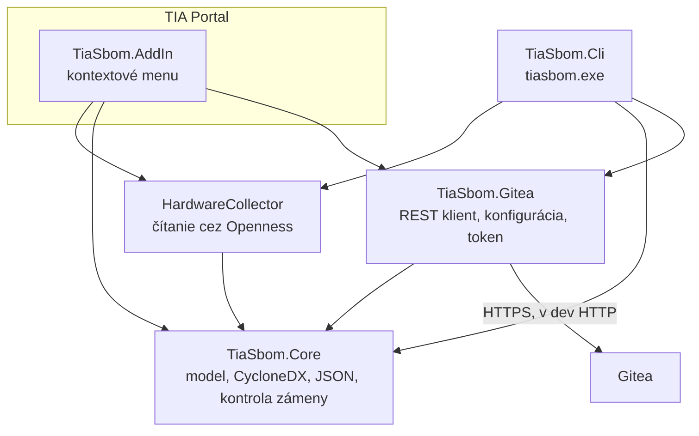
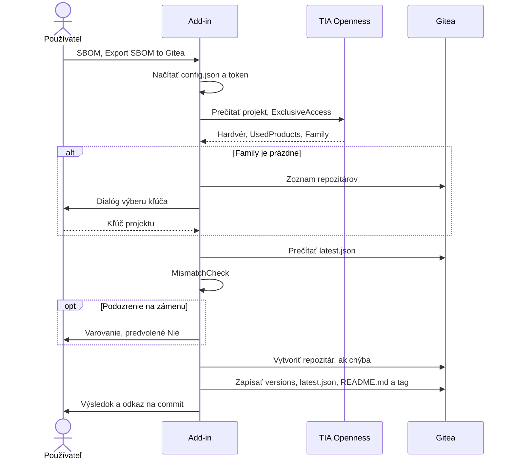
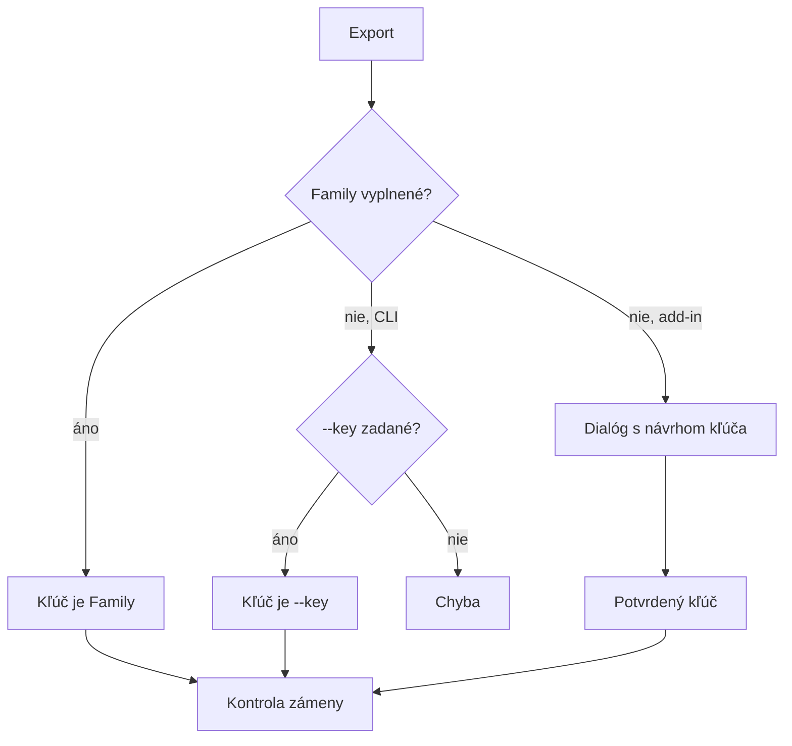

# Architektúra

## Účel

EU CRA vyžaduje poznať komponenty dodaných produktov a dlhodobo uchovávať podklady. Riešenie preto z každej verzie TIA projektu vytvorí SBOM a archivuje ho na mieste, kde ho vidia všetci a neskôr ho spracuje tracker zraniteľností.

Hlavné požiadavky:

- Používateľ klikne na jednu položku a nezadáva príkazy.
- Jeden Gitea repozitár na projekt, prehľadne pri jednom aj pri mnohých projektoch.
- Všetci vidia všetky SBOM.
- Ochrana pred uložením SBOM do cudzieho projektu.
- Podpora viacerých verzií TIA.
- Iba nástroje použiteľné vo veľkej firme bez platenia.

## Komponenty



| Komponent | Úloha | Kto ho používa |
|---|---|---|
| Add-in | Tlačidlo v TIA, dialógy, spustenie exportu | bežný používateľ |
| CLI `tiasbom.exe` | Ladenie, CI, hromadné spracovanie, `--dump-hw` | vývojár, administrátor |
| Gitea | Archív SBOM s históriou a tagmi | všetci |
| PostgreSQL | Databáza Gitea | server |
| Caddy | HTTPS pred Gitea | server |

## Export



## Projektový kľúč

Názvy TIA projektov sa vo firme líšia a menia sa s každou verziou. Stabilným identifikátorom je preto vlastnosť **Project → Properties → Family**, ktorá sa kopíruje so „Save as“ aj s archívom.

- `Family` určuje názov repozitára. Kód ho normalizuje na znaky `A-Za-z0-9_.-`.
- Ak je prázdne, add-in ponúkne existujúce repozitáre a navrhne číslo zákazky zo začiatku názvu projektu.
- Add-in `Family` nezapíše. Cez Openness je vlastnosť len na čítanie, používateľ ju nastaví v TIA.
- CLI vyžaduje `--key` alebo `Family`.



## Ochrana pred zámenou

`MismatchCheck` pred zápisom vyhodnotí tri pravidlá:

1. Číslo na začiatku názvu projektu sa nezhoduje s číselným kľúčom.
2. `Family` v projekte sa nezhoduje s cieľovým kľúčom. To je možné iba cez `--key`.
3. Menej ako 50 % zhodných modulov oproti `latest.json`. Modul je dvojica stanica a objednávacie číslo.

Add-in ukáže varovanie s predvolenou odpoveďou *Nie*. CLI odmietne zápis bez `--force`.

## Štruktúra v Gitea

```text
sbom/                                  organizácia
└── <kľúč>/                            jeden repozitár na projekt
    ├── README.md                      generovaný prehľad
    ├── latest.json                    posledný SBOM, vstup pre tracker
    └── versions/<názov projektu>/
        └── sbom.json                  SBOM jednej verzie projektu
```

Každá verzia má aj git tag s názvom projektu. Existujúci tag sa neprepisuje. Známy dôsledok opakovaného exportu je v [06-kod.md](06-kod.md#známe-problémy-a-vylepšenia).

Po ukončení zákazky sa repozitár v Gitea archivuje, čím je len na čítanie.

## Obsah SBOM

| Časť | Zdroj | Poznámka |
|---|---|---|
| `metadata.component` | názov, cesta, Family | `tia:*` vlastnosti |
| komponenty `application` | `Project.UsedProducts` | STEP 7, WinCC, Safety |
| komponenty `device` | položky zariadení s produktovou identitou | CPU, moduly, panely, GSD |
| vnorené `firmware` | `FirmwareVersion` alebo `TypeIdentifier` | kľúč pre párovanie zraniteľností |

Vlastnosti `tia:version` a `tia:opennessApi` sú zámerne oddelené. Build V17 môže bežať na TIA V20, verzia API teda nie je verzia TIA. Skutočnú verziu určuje prípona projektu, napríklad `.ap19`.

Do SBOM nejdú položky bez produktovej identity: rozhrania, porty, moduly GSD bez objednávacieho čísla, stojan S7-1200 s číslom `Rack`.

**Mimo rozsahu:** PLC bloky, knižnice, HMI skripty a softvér tretích strán v projekte. Ide o známe obmedzenie, pozri [STATUS.md](STATUS.md).

## Verzie TIA

Jeden zdrojový kód, jeden build na Openness API:

| Build | Beží na TIA | .NET | Poznámka |
|---|---|---|---|
| `V16` | V16 až V19 | 4.6.2 | CLI, zatiaľ nezostavené |
| `V17` | V17 až V20 | 4.8 | CLI aj add-in |
| `V21` | iba V21 | 4.8 | CLI aj add-in, modulárne DLL |

Podrobnosti a testy sú v [07-testovanie-verzii.md](07-testovanie-verzii.md).

Starší projekt sa neotvára cez `OpenWithUpgrade`. Vznikla by povýšená kópia a SBOM by neopisoval dodaný projekt.

## Kľúčové rozhodnutia

| Rozhodnutie | Dôvod |
|---|---|
| Gitea namiesto GitLab | Jednoduchá prevádzka, MIT licencia |
| CycloneDX 1.6 JSON | Otvorený štandard vhodný na párovanie zraniteľností |
| REST API namiesto `git.exe` | Na inžinierskom počítači netreba Git |
| Vlastný JSON zapisovač a parser | Add-in nemá binding redirects a sandbox V17 odmieta `JavaScriptSerializer` |
| Žiadne NuGet balíky | Rovnaký dôvod, menej rizika v procese TIA |
| `Family` ako kľúč | Stabilné naprieč verziami projektu |
| Repozitár na projekt | Prehľadnosť, archivácia po zákazke |
| Repozitáre viditeľné v rámci organizácie | Všetci majú vidieť všetky SBOM. Prístup v produkcii rieši [04-produkcia.md](04-produkcia.md) |
| DPAPI cez `crypt32` | Šifrovaný token na používateľa, funguje v sandboxe |

## Licencie

Firma je veľká, preto sa používa iba softvér bez licenčného obmedzenia pre podniky.

| Nástroj | Licencia alebo podmienka | Stav |
|---|---|---|
| Gitea | MIT | povolené |
| PostgreSQL | PostgreSQL License | povolené |
| Caddy | Apache 2.0 | povolené |
| Docker Engine vo WSL | Apache 2.0 | povolené |
| Ubuntu, WSL | open source, súčasť Windows | povolené |
| .NET SDK | MIT | povolené |
| VS Code a extension C# | bezplatné | povolené |
| Git | GPL v2 | povolené |
| CycloneDX | otvorený štandard | povolené |
| TIA Portal a Openness | existujúca licencia TIA | povolené |
| Visual Studio Community | podnik s obratom nad 1 mil. USD ho nesmie používať | **zakázané** |
| C# Dev Kit | viazaný na licenciu Visual Studio | **zakázané** |
| Docker Desktop | platený pre väčšie firmy | **nepoužívať** |

Licenčné podmienky pred ostrou prevádzkou overte v aktuálnych zneniach.
