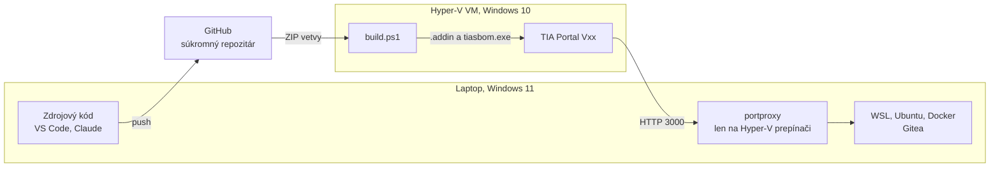
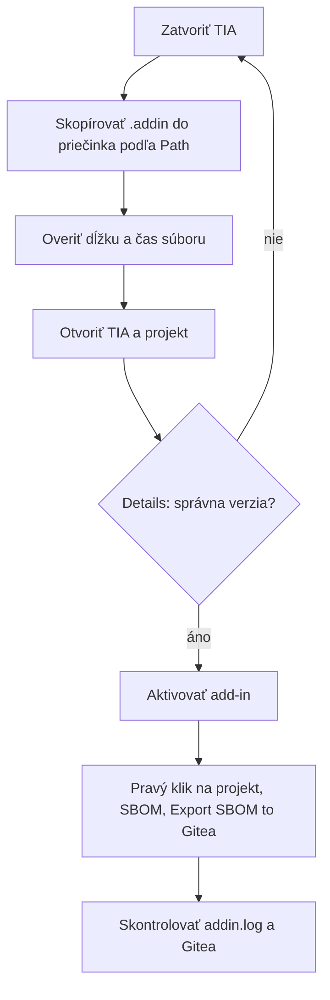

# Vývojové prostredie a nová VM

## Prehľad



Na laptope **nie je** .NET SDK ani TIA. Kód sa píše na laptope, prekladá a testuje vo VM. Každá VM obsahuje jednu verziu TIA.

## Príprava novej VM

Predpoklad: VM s Windows 10 alebo 11 v Hyper-V a nainštalovaný TIA Portal s Openness. Pripojte ju na **Default Switch**, aby sa dostala ku Gitea. Pozri [03-gitea-server.md](03-gitea-server.md#pripojenie-z-vm).

### 1. Kopírovanie do VM

- Text: zapnite v Hyper-V **View → Enhanced Session** a použite Ctrl+C a Ctrl+V.
- Súbory z laptopu: v Enhanced Session cez Ctrl+C a Ctrl+V alebo `\\tsclient\C`.
- `\\tsclient\C` nefunguje v PowerShelli spustenom ako správca. Použite prieskumník alebo bežný PowerShell.

### 2. Nástroje

Spustite vo VM v PowerShelli ako správca:

```powershell
winget install --id Microsoft.DotNet.SDK.8 -e --accept-package-agreements --accept-source-agreements
```

.NET SDK si pri preklade stiahne referenčné zostavenia `net48` z NuGetu, ak chýba Developer Pack. Overené na VM s V19, ktorá má iba `v4.8.1`. Do výstupu sa nedostanú, vyžadujú však internet pri prvom builde. Bez internetu nainštalujte **.NET Framework 4.8 Developer Pack** z `https://dotnet.microsoft.com/download/dotnet-framework/net48`. Balík `winget` `Microsoft.DotNet.Framework.DeveloperPack_4` inštaluje 4.8.1, nie 4.8. Git ani Visual Studio netreba.

Po inštalácii otvorte nové okno PowerShellu a overte:

```powershell
dotnet --list-sdks
```

### 3. Skupina Openness

```powershell
net localgroup "Siemens TIA Openness" "$env:USERDOMAIN\$env:USERNAME" /add
```

Odhláste sa a znova prihláste. Do toho času členstvo neplatí. Overenie:

```powershell
whoami /groups | Select-String "Openness"
```

### 4. Kód

Vo VM otvorte v prehliadači, prihlásený na GitHube, tento odkaz na vetvu:

```text
https://github.com/xsugra/tia-sbom-utility/archive/refs/heads/main.zip
```

Rozbaľte ho:

```powershell
$zip = Get-ChildItem "$env:USERPROFILE\Downloads\tia-sbom-utility-*.zip" | Sort-Object LastWriteTime -Descending | Select-Object -First 1
$zip | Select-Object Name, Length, LastWriteTime
Expand-Archive $zip.FullName -DestinationPath C:\Code -Force
Get-ChildItem C:\Code -Directory -Filter 'tia-sbom-utility-*' | Select-Object FullName, LastWriteTime
```

Skontrolujte čas ZIP-u. Ak vo výpise nie je aktuálny čas, stiahnutie neprebehlo.

Priečinok závisí od vetvy: `tia-sbom-utility-main` alebo `tia-sbom-utility-feat-multi-version-tia`.

**Over verziu pred buildom:**

```powershell
cd C:\Code\tia-sbom-utility-main\TiaSbom
Select-String -Path .\src\TiaSbom.AddIn\AddInPublisherConfig.V17.xml -Pattern '<Version>'
```

### 5. Build

| TIA | Príkaz |
|---|---|
| V17 | `.\build.ps1 -Api V17 -AddIn` |
| V21 | `.\build.ps1 -Api V21 -AddIn` |
| V19 | CLI: `.\build.ps1 -Api V17 -Portal V19`, add-in: `.\build.ps1 -Api V19 -AddIn` |
| V18, V20 | CLI: `.\build.ps1 -Api V17 -Portal V20`, add-in podľa [testov](07-testovanie-verzii.md) |
| V16 | `.\build.ps1 -Api V16`, add-in zatiaľ nie je |

Spustenie, ak je zablokované vykonávanie skriptov:

```powershell
powershell -ExecutionPolicy Bypass -File .\build.ps1 -Api V17 -AddIn
```

Výstupy:

```text
src\TiaSbom.Cli\bin\<Api>\Release\net48\tiasbom.exe
src\TiaSbom.AddIn\bin\<Api>\Release\net48\TiaSbom.<Api>.addin
```

`build.ps1` používa `--no-incremental`, lebo ZIP z GitHubu obnoví staré časy súborov a MSBuild by zmenu nezistil.

### 6. Konfigurácia

```powershell
New-Item -ItemType Directory -Force "$env:ProgramData\TiaSbom" | Out-Null
$gw = (Get-NetIPConfiguration | Where-Object { $_.IPv4DefaultGateway } | Select-Object -First 1).IPv4DefaultGateway.NextHop
$gw
Test-NetConnection $gw -Port 3000 | Select-Object RemoteAddress, TcpTestSucceeded
```

Pri `TcpTestSucceeded = True` zapíšte konfiguráciu. Na Default Switch býva brána zároveň adresou laptopu:

```powershell
@{ BaseUrl = "http://${gw}:3000"; Owner = "sbom"; Branch = "main"; TimeoutSeconds = 10 } | ConvertTo-Json | Set-Content "$env:ProgramData\TiaSbom\config.json" -Encoding UTF8
Get-Content "$env:ProgramData\TiaSbom\config.json"
```

`Token` v tomto súbore vo vývoji nepoužívajte.

### 7. Token

Token s oprávneniami **organization: Read and Write** a **repository: Read and Write** vytvorte podľa [03-gitea-server.md](03-gitea-server.md#tokeny). Vloží sa jedným z týchto spôsobov:

- add-in sa naň spýta pri prvom exporte,
- alebo príkazom:

```powershell
.\src\TiaSbom.Cli\bin\V17\Release\net48\tiasbom.exe --login
```

Token je šifrovaný pre aktuálneho používateľa v `%APPDATA%\TiaSbom\token.bin`.

### 8. Test CLI

Otvorte projekt v TIA a spustite:

```powershell
.\src\TiaSbom.Cli\bin\V17\Release\net48\tiasbom.exe --attach --dump-hw --out sbom-test.json
```

Pri prvom spustení nového `.exe` ukáže TIA okno brány Openness. **Môže sa schovať za iné okná a príkaz vtedy čaká.** Potvrďte ho v TIA.

## Nasadenie add-inu

Inštalátor to spraví za vás, pozri [09-instalacia.md](09-instalacia.md). Ručný postup je tu pre prípad, že ho treba preskúmať.


### Kam

Priečinok závisí od verzie a overuje sa v TIA, nikdy sa nehádže.

| TIA | Overená cesta |
|---|---|
| V17 | `C:\Program Files\Siemens\Automation\Portal V17\AddIns` |
| V19 | `C:\Program Files\Siemens\Automation\Portal V19\AddIns` |
| V21 | `%APPDATA%\Siemens\Automation\Portal V21\UserAddIns`, súbor `TiaSbom.addin` |
| ostatné | zistiť a zapísať do [testov](07-testovanie-verzii.md) |

V TIA otvorte vpravo záložku **Add-ins**, vyberte add-in a rozbaľte **Details**. **Path** a **Version** sú rozhodujúce. V17 má jednu skupinu `AddIns`, V21 skupiny Corporate, System a User.

### Postup



Príklad pre V17, v PowerShelli ako správca:

```powershell
Copy-Item .\src\TiaSbom.AddIn\bin\V17\Release\net48\TiaSbom.V17.addin "C:\Program Files\Siemens\Automation\Portal V17\AddIns\" -Force
Get-Item "C:\Program Files\Siemens\Automation\Portal V17\AddIns\TiaSbom.V17.addin" | Select-Object Length, LastWriteTime
```

Pri novom balíku môže TIA vypnúť add-in a pýtať sa na potvrdenie oprávnení. Skontrolujte zelenú fajku.

### Diagnostika

```powershell
Get-Content "$env:APPDATA\TiaSbom\addin.log" -Tail 30
```

Log neobsahuje token. Ak chýba úplne, nebeží nový add-in.

## Práca s vetvami

- Vývoj prebieha vo feature vetve, teraz `feat/multi-version-tia`.
- `main` sa posúva až po overení na TIA.
- Remote sa volá `tia-sbom-utility`:

```bash
git remote -v
```

## Lokálny súbor prostredia

Vytvorte `docs/local/environment.md`, Git ho ignoruje:

```markdown
# Lokálne prostredie

## Stroje
| Stroj | Názov | Účel |
|---|---|---|
| Laptop | ... | kód, WSL, Gitea |
| VM V17 | ... | TIA V17 |
| VM V21 | ... | TIA V21 |

## Sieť
- Adresa Default Switch: ...
- BaseUrl vo VM: ...

## Účty
- Používateľ WSL: ...
- Účet vo VM: ...

## Testovacie projekty
| Verzia TIA | Kľúč | Popis |
|---|---|---|
```

Nikdy tam nepíšte tokeny ani heslá.
