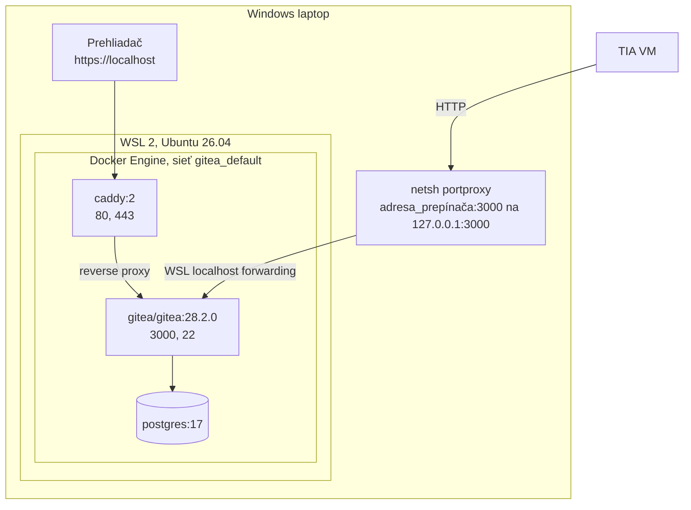
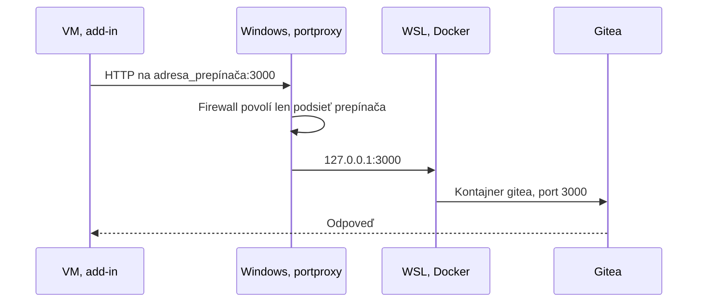
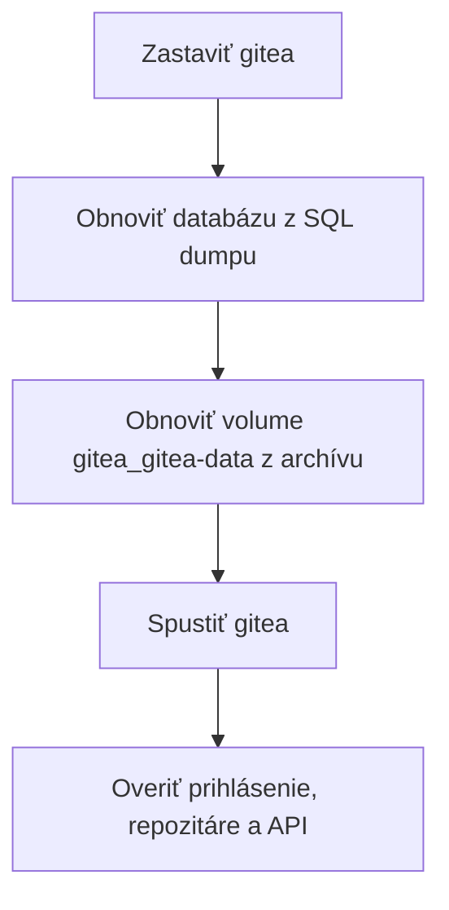

# Gitea server

Tento dokument opisuje **vývojovú inštanciu** na laptope. Produkčný server je v [04-produkcia.md](04-produkcia.md).

## Stack



| Položka | Hodnota |
|---|---|
| Distribúcia | Ubuntu 26.04 LTS vo WSL 2 |
| Priečinok | `~/docker/gitea` |
| Súbory | `docker-compose.yml`, `Caddyfile`, `.env` |
| Tajomstvá | iba v `.env`, práva `600` |
| Volumes | `gitea_db-data`, `gitea_gitea-data`, `gitea_caddy-data` |
| Reštart | `unless-stopped`, Docker je povolený v systemd |
| Registrácia | vypnutá, účty zakladá administrátor |

Publikované porty: `80`, `443`, `3000`, `2222`. Porty `5432` a databáza nie sú publikované.

## Prístup do WSL

Z PowerShellu na laptope:

```powershell
wsl -d Ubuntu-26.04
```

Potom vo WSL:

```bash
cd ~/docker/gitea
docker compose ps
```

Jediný príkaz bez vstupu do WSL:

```powershell
wsl -d Ubuntu-26.04 -- docker ps
```

Sieťový režim WSL je predvolený NAT, súbor `.wslconfig` neexistuje.

## Spustenie po reštarte

**WSL sa po štarte Windows nespúšťa samo.** Kým nikto neotvorí WSL, Gitea nebeží a VM dostane chybu pripojenia. Po reštarte laptopu teda:

1. Spustite WSL. Docker a kontajnery naštartujú samy.
2. Skontrolujte adresu prepínača podľa [Pripojenie z VM](#pripojenie-z-vm).
3. Overte Gitea:

```powershell
curl.exe -s http://127.0.0.1:3000/api/v1/version
```

## Prihlásenie na web

Web otvárajte **iba** cez `https://localhost`.

`ROOT_URL` je `https://localhost/`, preto má prihlasovacie cookie príznak Secure. Pri prihlásení cez `http://...:3000` Gitea nič nehlási a prihlásenie sa ticho neuloží. Port 3000 slúži len na API z VM.

Prehliadač upozorní na certifikát: Caddy ho vydáva vlastnou lokálnou autoritou (`tls internal`).

## Pripojenie z VM



Prečo takto: VM vidí laptop cez Hyper-V Default Switch, ale port WSL je dostupný iba na `127.0.0.1` laptopu. `portproxy` ho sprístupní **výhradne** na adrese prepínača.

**Nikdy nepoužívajte `listenaddress=0.0.0.0`.** Gitea by bola dostupná z firemnej siete cez nešifrované HTTP.

### Zmena adresy prepínača

Default Switch môže po reštarte dostať novú adresu. VM potom hlási `An error occurred while sending the request` a `addin.log` obsahuje timeout na starú adresu.

Na **laptope** zistite adresu:

```powershell
Get-NetIPAddress -InterfaceAlias 'vEthernet (Default Switch)' -AddressFamily IPv4 | Select-Object IPAddress, PrefixLength
netsh interface portproxy show v4tov4
```

Ak sa líši, spustite v PowerShelli **ako správca** tento skript. Pred spustením si skontrolujte vypísané hodnoty:

```powershell
$a = Get-NetIPAddress -InterfaceAlias 'vEthernet (Default Switch)' -AddressFamily IPv4
$ip = $a.IPAddress
$net = (Get-NetRoute -InterfaceAlias 'vEthernet (Default Switch)' -AddressFamily IPv4 | Where-Object { $_.DestinationPrefix -like "*/$($a.PrefixLength)" } | Select-Object -First 1).DestinationPrefix
"Adresa: $ip, podsieť: $net"
netsh interface portproxy reset
netsh interface portproxy add v4tov4 listenaddress=$ip listenport=3000 connectaddress=127.0.0.1 connectport=3000
Remove-NetFirewallRule -DisplayName "Gitea for TIA VM" -ErrorAction SilentlyContinue
New-NetFirewallRule -DisplayName "Gitea for TIA VM" -Direction Inbound -Protocol TCP -LocalAddress $ip -RemoteAddress $net -LocalPort 3000 -Action Allow | Out-Null
```

Príkaz `reset` zmaže všetky pravidlá `portproxy` na laptope. Ak používate aj iné, odstráňte iba toto pravidlo.

Potom vo **VM** opravte `BaseUrl`:

```powershell
$c = "$env:ProgramData\TiaSbom\config.json"
Get-Content $c
```

Upravte adresu a overte spojenie. Test z VM:

```powershell
$u = (Get-Content "$env:ProgramData\TiaSbom\config.json" -Raw | ConvertFrom-Json).BaseUrl
Invoke-RestMethod "$u/api/v1/version"
```

Konfiguráciu netreba načítať reštartom TIA, číta sa pri každom exporte.

## Organizácia a účty

| Položka | Hodnota |
|---|---|
| Organizácia | `sbom` |
| Repozitáre | zakladá ich export automaticky |
| Viditeľnosť | verejné, `PrivateRepos=false` |

## Tokeny

V Gitea: **Settings → Applications → Generate New Token**.

| Oprávnenie | Úroveň | Prečo |
|---|---|---|
| organization | Read and Write | vytváranie repozitárov v organizácii, zoznam |
| repository | Read and Write | súbory a tagy |

Chyby:

- `403 token does not have at least one of required scope(s)`: chýba oprávnenie.
- `404` pri organizácii: organizácia `sbom` neexistuje.

Token sa zobrazí iba raz. Nikam ho neukladajte v čitateľnej podobe.

## Bežná správa

Všetko sa spúšťa vo WSL v `~/docker/gitea`.

```bash
docker compose ps
docker compose logs --tail 100 gitea
docker compose restart gitea
```

Administrácia používateľov:

```bash
docker compose exec -u git gitea gitea admin user list
```

### Aktualizácia Gitea

1. Urobte zálohu.
2. Prečítajte poznámky k vydaniu.
3. Zmeňte tag obrazu v `docker-compose.yml`. Nepoužívajte `latest`.
4. Spustite:

```bash
docker compose pull gitea
docker compose up -d gitea
docker compose logs --tail 50 gitea
```

## Záloha

**Momentálne neexistuje žiadna pravidelná záloha.** Vývojová inštancia je jediné miesto s testovacími SBOM.

Ručná záloha do `~/backups`, vo WSL:

```bash
cd ~/docker/gitea
mkdir -p ~/backups
docker compose exec -T db pg_dump -U gitea gitea | gzip > ~/backups/gitea-db-$(date +%F).sql.gz
docker compose stop gitea
docker run --rm -v gitea_gitea-data:/data:ro -v ~/backups:/backup alpine tar czf /backup/gitea-data-$(date +%F).tgz -C /data .
docker compose start gitea
cp docker-compose.yml Caddyfile ~/backups/
ls -la ~/backups
```

`.env` zálohujte oddelene, šifrovane. Záloha obsahuje tajomstvá z `app.ini`, zaobchádzajte s ňou ako s heslom. Zálohu ukladajte mimo WSL, pád distribúcie by ju zničil spolu s dátami.

## Obnova

Obnovu najprv vyskúšajte na testovacom projekte Compose, kým sa na ňu spoľahnete.



## Čo je v priečinku navyše

| Položka | Stav |
|---|---|
| `old-sqlite/` | pozostatok pôvodnej inštalácie so SQLite, vlastník `root` |
| `docker-compose.yml.bak` | stav pred pridaním portu 3000 |
| volume `restoretest_gitea-data` | pozostatok testu obnovy |
| tri volumes s hash názvom | anonymné, neznámy účel |

Nič z toho nemažte bez kontroly obsahu.

## Riešenie problémov

Pozri [08-riesenie-problemov.md](08-riesenie-problemov.md#gitea-a-sieť).
