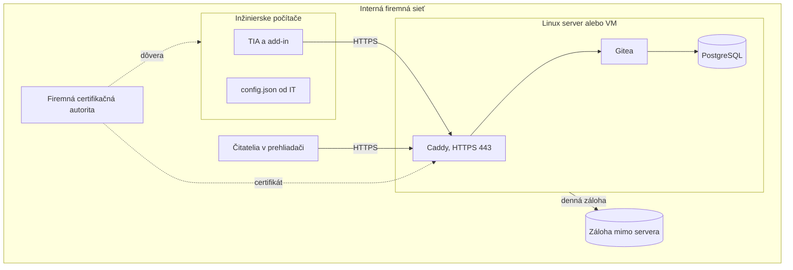
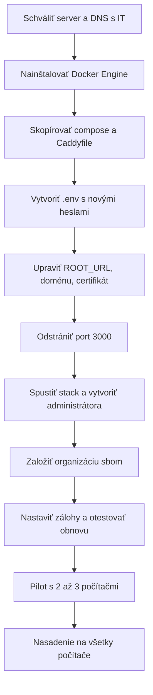

# Produkčná prevádzka

Architektúra sa pre produkciu nemení. Mení sa miesto behu a zabezpečenie. Firma má približne 60 až 70 počítačov.

## Cieľový stav



## Rozdiely oproti vývoju

| Oblasť | Vývoj | Produkcia |
|---|---|---|
| Server | Laptop, WSL | Trvalý Linux server alebo VM, spúšťa sa so systémom |
| Adresa | `https://localhost` | Interné DNS meno, napríklad `gitea.firma.local` |
| Certifikát | Caddy `tls internal` | Certifikát firemnej CA, dôveryhodný na počítačoch |
| Port 3000 | Publikovaný pre VM | **Odstrániť** z `docker-compose.yml` |
| Prístup | `portproxy` | Priamo cez HTTPS 443 |
| `portproxy`, pravidlo firewallu | Existujú | Na serveri nie sú |
| Token | Osobný | Servisný účet v `config.json` alebo osobné tokeny |
| Čítanie bez prihlásenia | Povolené | Rozhodnúť, odporúčané `REQUIRE_SIGNIN_VIEW=true` |
| Zálohy | Žiadne | Denne, mimo server, s testom obnovy |
| Add-in | Nepodpísaný, autor `YourCompany` | Podpísaný, skutočný autor |
| Nasadenie | `install.ps1` | Inštalátor cez GPO, pozri [09-instalacia.md](09-instalacia.md) |
| SSH port 2222 | Publikovaný | Vypnúť, ak ho nikto nepoužíva |

## Čo server potrebuje

| Položka | Požiadavka |
|---|---|
| OS | Ubuntu LTS alebo iný podporovaný Linux |
| Softvér | Docker Engine, Compose plugin |
| Výkon | 2 vCPU, 4 GB RAM, 50 GB disk ako začiatok |
| Sieť | Pevná adresa, DNS meno, 443 z firemnej siete |
| Čas | NTP |
| Správa | Vlastník, pravidelné aktualizácie OS a obrazov |

Veľkosť je odhad. Jeden SBOM má rádovo desiatky kB, rozhoduje najmä počet verzií a história.

## Postup nasadenia



### Konfigurácia Gitea

Príklad úpravy v `docker-compose.yml`:

```yaml
  gitea:
    environment:
      - GITEA__server__ROOT_URL=https://gitea.firma.local/
      - GITEA__server__DOMAIN=gitea.firma.local
      - GITEA__server__SSH_DOMAIN=gitea.firma.local
      - GITEA__service__DISABLE_REGISTRATION=true
      - GITEA__service__REQUIRE_SIGNIN_VIEW=true
    ports: []
```

`Caddyfile` s certifikátom firemnej CA:

```text
gitea.firma.local {
    tls /etc/caddy/certs/gitea.crt /etc/caddy/certs/gitea.key
    reverse_proxy gitea:3000
}
```

Certifikát a kľúč pripojte ako volume len na čítanie. Nepatria do Gitu.

Pri `REQUIRE_SIGNIN_VIEW=true` musia mať čitatelia účet. Zvážte prihlasovanie cez firemné LDAP alebo AD.

### Konfigurácia počítačov

`%ProgramData%\TiaSbom\config.json`, nasadí IT, používatelia ho môžu iba čítať:

```json
{
  "BaseUrl": "https://gitea.firma.local",
  "Owner": "sbom",
  "Branch": "main",
  "PrivateRepos": false,
  "TimeoutSeconds": 60,
  "Token": ""
}
```

### Tokeny v produkcii

| Možnosť | Výhoda | Nevýhoda |
|---|---|---|
| Servisný účet v `config.json` | Žiadna práca pre používateľa | Čitateľný pre každého na počítači, v histórii je jeden autor tokenu |
| Osobný token | Sledovateľnosť, DPAPI | Každý ho musí vytvoriť a obnovovať |

Servisný účet smie mať práva iba na organizáciu `sbom`. Commit obsahuje meno Windows používateľa aj pri servisnom účte.

Rozhodnutie je otvorené. Pri servisnom tokene nastavte práva súboru tak, aby ho mohli čítať iba používatelia TIA.

### Add-in pre firmu

1. Zmeňte `Author` v `AddInPublisherConfig.*.xml`.
2. Podpíšte balík firemným certifikátom. Publisher podporuje `Certificates` v konfigurácii. Postup je nutné overiť.
3. Rozhodnite, ktoré buildy sa nasadzujú podľa [testov](07-testovanie-verzii.md).
4. IT nasadí `.addin` do priečinka, ktorý TIA číta. V21 ukazuje skupinu *Corporate Add-Ins*, jej cesta nie je overená.
5. Overte, či musia byť používatelia v skupine `Siemens TIA Openness`. Pri CLI je to povinné, pri add-ine to nie je overené.
6. V21 má `UnrestrictedAccess`, overte akceptáciu bezpečnosťou.

### Používateľ

1. Pri prvom použití vyplní **Project → Properties → Family**.
2. Klikne pravým tlačidlom na projekt a zvolí **SBOM → Export SBOM to Gitea**.
3. SBOM exportuje pri každom vydaní projektu.

## Zálohy a archív

CRA vyžaduje uchovať dokumentáciu dlhodobo, počítajte s 10 rokmi.

| Požiadavka | Riešenie |
|---|---|
| Denná záloha | `pg_dump` a archív volume, príklad v [03-gitea-server.md](03-gitea-server.md#záloha) |
| Mimo server | Firemné úložisko so zálohovaním |
| Test obnovy | Aspoň raz ročne, zapísať výsledok |
| Ukončená zákazka | Repozitár v Gitea *Archive* |
| Migrácia | Git história sa dá presunúť na iný server |

Požadovanú dobu uchovania potvrďte s právnym oddelením.

## Monitoring

- Dostupnosť `https://gitea.firma.local/api/healthz`.
- Voľné miesto na disku.
- Výsledok poslednej zálohy.
- Platnosť certifikátu.

## Akceptačný zoznam

- [ ] Server beží po reštarte bez zásahu.
- [ ] Port 3000 a databáza nie sú dostupné z firemnej siete.
- [ ] HTTPS je dôveryhodné na inžinierskom počítači bez varovania.
- [ ] `ROOT_URL` zodpovedá skutočnej adrese a prihlásenie funguje.
- [ ] Registrácia je vypnutá a heslá sú nové, nie z vývoja.
- [ ] Záloha prebehne automaticky a obnova je otestovaná.
- [ ] Add-in je podpísaný a nasadený cez IT.
- [ ] Bežný používateľ bez práv správcu dokončí export.
- [ ] Každá používaná verzia TIA prešla [testom](07-testovanie-verzii.md).
- [ ] Bezpečnostné pravidlá a vlastník servera sú schválené.

## Prenos dát z vývoja

Vývojová inštancia obsahuje iba testovacie exporty. Do produkcie ich neprenášajte, projekty sa exportujú nanovo.
