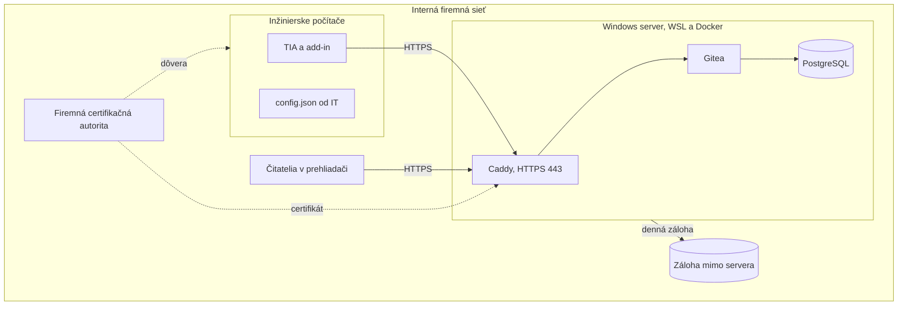
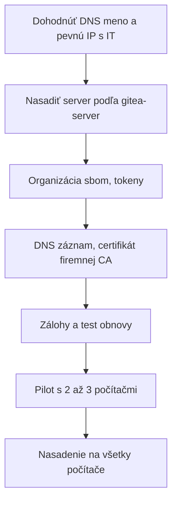

# Produkčná prevádzka

Architektúra sa pre produkciu nemení. Mení sa miesto behu a zabezpečenie. Firma má približne 60 až 70 počítačov.

## Cieľový stav



## Rozdiely oproti vývoju

| Oblasť | Vývoj | Produkcia |
|---|---|---|
| Server | Laptop, WSL | Trvalý Windows stroj, WSL a Docker Engine, štart so systémom |
| Adresa | `https://localhost` | Interné DNS meno, napríklad `gitea.firma.internal`. Nie `.local`, tú používa mDNS |
| Certifikát | Caddy `tls internal` | Certifikát firemnej CA, dôveryhodný na počítačoch |
| Port 3000 | Publikovaný pre VM | Nepublikovaný, `docker-compose.yml` v `gitea-server` |
| Prístup | `portproxy` 3000, len prepínač | `portproxy` 443 a 80 na LAN adrese, firewall profil Domain |
| Token | Osobný | Servisný účet v `config.json` alebo osobné tokeny |
| Čítanie bez prihlásenia | Povolené | Rozhodnúť, odporúčané `REQUIRE_SIGNIN_VIEW=true` |
| Zálohy | Žiadne | Denne, mimo server, s testom obnovy |
| Add-in | Nepodpísaný, autor `YourCompany` | Podpísaný, skutočný autor |
| Nasadenie | `install.ps1` | Inštalátor cez GPO, pozri [09-instalacia.md](09-instalacia.md) |
| SSH port 2222 | Publikovaný | Vypnutý, `DISABLE_SSH=true` |

## Server

Konfigurácia servera a jeho dokumentácia sú v samostatnom súkromnom repozitári [xsugra/gitea-server](https://github.com/xsugra/gitea-server), lokálne v `C:\Code\gitea-server`:

| Téma | Dokument v `gitea-server` |
|---|---|
| Požiadavky, nasadenie na Windows s WSL, sieť, certifikát, štart so systémom | [docs/nasadenie.md](https://github.com/xsugra/gitea-server/blob/main/docs/nasadenie.md) |
| Správa, aktualizácia, záloha, obnova, monitoring | [docs/sprava.md](https://github.com/xsugra/gitea-server/blob/main/docs/sprava.md) |
| Sieť a tajomstvá servera | [docs/bezpecnost.md](https://github.com/xsugra/gitea-server/blob/main/docs/bezpecnost.md) |
| Chyby servera | [docs/riesenie-problemov.md](https://github.com/xsugra/gitea-server/blob/main/docs/riesenie-problemov.md) |

Poradie pre celý projekt:



### Konfigurácia počítačov

`%ProgramData%\TiaSbom\config.json`, nasadí IT, používatelia ho môžu iba čítať:

```json
{
  "BaseUrl": "https://gitea.firma.internal",
  "Owner": "sbom",
  "Branch": "main",
  "PrivateRepos": false,
  "TimeoutSeconds": 60,
  "Token": ""
}
```

### Tokeny v produkcii

| Možnosť | Výhoda | Nevýhoda |
|---|---|---|
| Servisný účet v `config.json` | Žiadna práca pre používateľa | Čitateľný pre každého na počítači, v histórii je jeden autor tokenu |
| Osobný token | Sledovateľnosť, DPAPI | Každý ho musí vytvoriť a obnovovať |

Servisný účet smie mať práva iba na organizáciu `sbom`. Commit obsahuje meno Windows používateľa aj pri servisnom účte.

Rozhodnutie je otvorené. Pri servisnom tokene nastavte práva súboru tak, aby ho mohli čítať iba používatelia TIA.

### Add-in pre firmu

1. Zmeňte `Author` v `AddInPublisherConfig.*.xml`.
2. Podpíšte balík firemným certifikátom. Publisher podporuje `Certificates` v konfigurácii. Postup je nutné overiť.
3. Rozhodnite, ktoré buildy sa nasadzujú podľa [testov](07-testovanie-verzii.md).
4. IT nasadí `.addin` inštalátorom s `ADDIN_SCOPE=corporate`. Na V21 je to `C:\ProgramData\Siemens\Automation\Portal V21\CorporateAddIns`, overené 2026-11-18. Pozri [09-instalacia.md](09-instalacia.md#nasadenie-na-10-až-20-počítačov).
5. Počítajte s tým, že **každý používateľ add-in aktivuje sám, aj po každej aktualizácii**. Overené na V21 pri nepodpísanom balíku. Či podpis niečo zmení, treba zistiť.
6. Overte, či musia byť používatelia v skupine `Siemens TIA Openness`. Pri CLI je to povinné, pri add-ine to nie je overené.
7. V21 má `UnrestrictedAccess`, overte akceptáciu bezpečnosťou.

### Adresa servera

Vývoj ukázal, že meniaca sa adresa je najčastejšia príčina chýb (`TS-NET-04`). Na Hyper-V Default Switch sa adresa mení po reštarte laptopu.

- Produkčná Gitea musí mať **stálu adresu**: DNS meno, napríklad `gitea.firma.local`, alebo pevnú IP. `portproxy` na serveri smeruje iba z jeho stálej adresy do WSL podľa `gitea-server`, nikdy nie na adresu, ktorá sa mení.
- **HTTPS** s certifikátom, ktorému inžinierske PC dôverujú. Inak každý export skončí `TS-TLS-01`. Firemnú CA nasadí IT.
- Firewall servera (Windows alebo ESET) povolí 443 zo siete inžinierov.
- Po nasadení na každom PC `install.cmd` musí skončiť kódom 0, potom `check.cmd` u používateľa.

### Používateľ

1. Pri prvom použití vyplní **Project → Properties → Family**.
2. Klikne pravým tlačidlom na projekt a zvolí **SBOM → Export SBOM to Gitea**.
3. SBOM exportuje pri každom vydaní projektu.

## Zálohy a archív

CRA vyžaduje uchovať dokumentáciu dlhodobo, počítajte s 10 rokmi.

| Požiadavka | Riešenie |
|---|---|
| Denná záloha | `pg_dump` a archív volume, [gitea-server: sprava.md](https://github.com/xsugra/gitea-server/blob/main/docs/sprava.md#záloha) |
| Mimo server | Firemné úložisko so zálohovaním |
| Test obnovy | Aspoň raz ročne, zapísať výsledok |
| Ukončená zákazka | Repozitár v Gitea *Archive* |
| Migrácia | Git história sa dá presunúť na iný server |

Požadovanú dobu uchovania potvrďte s právnym oddelením.

## Monitoring

Pozri [gitea-server: sprava.md](https://github.com/xsugra/gitea-server/blob/main/docs/sprava.md#monitoring).

## Akceptačný zoznam

- [ ] Server beží po reštarte bez zásahu.
- [ ] Port 3000 a databáza nie sú dostupné z firemnej siete.
- [ ] HTTPS je dôveryhodné na inžinierskom počítači bez varovania.
- [ ] `ROOT_URL` zodpovedá skutočnej adrese a prihlásenie funguje.
- [ ] Registrácia je vypnutá a heslá sú nové, nie z vývoja.
- [ ] Záloha prebehne automaticky a obnova je otestovaná.
- [ ] Add-in je podpísaný a nasadený cez IT.
- [ ] `install.cmd` skončí na každom PC kódom 0 a `check.cmd` u používateľa hlási `RESULT: OK`.
- [ ] `./test.sh` prejde na vydávanej verzii, integračné testy proti vývojovej Gitea.
- [ ] Bežný používateľ bez práv správcu dokončí export.
- [ ] Každá používaná verzia TIA prešla [testom](07-testovanie-verzii.md).
- [ ] Bezpečnostné pravidlá a vlastník servera sú schválené.

## Prenos dát z vývoja

Vývojová inštancia obsahuje iba testovacie exporty. Do produkcie ich neprenášajte, projekty sa exportujú nanovo.

## Ochrana archívu

Token so zápisom vie meniť históriu, preto musí archív chrániť aj nastavenie Gitea. Kód to nerieši, nastaví to administrátor:

- Servisný účet nesmie byť **Owner** organizácie, stačí tím s právom zápisu a vytvárania repozitárov.
- Vetva `main` má zakázaný force push.
- Mazanie repozitárov smie iba administrátor.
- Pravidelná záloha mimo server je posledná poistka.

Nastavenia overte na testovacom repozitári, kým sa použijú všade, aby nezablokovali zápis z add-inu.
