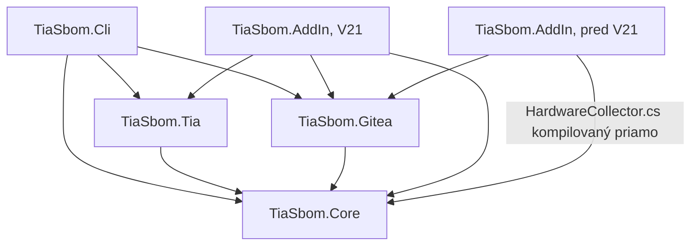
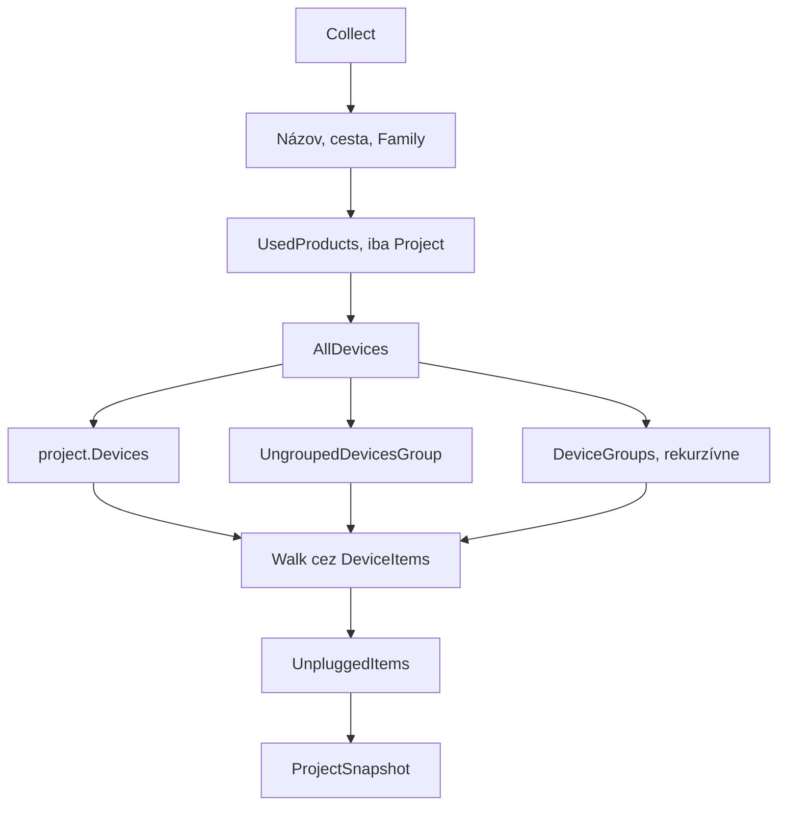

# Dokumentácia kódu

Riešenie je v `TiaSbom/`. Má približne 2000 riadkov C#, bez NuGet závislostí a bez testovacieho projektu.

## Štruktúra

```text
TiaSbom/
├── Directory.Build.props     spoločné nastavenia, voľba API, cesty k DLL
├── build.ps1                 build CLI a balenie add-inu
├── TiaSbom.sln
├── deploy/config.example.json
└── src/
    ├── TiaSbom.Core/         bez závislosti na TIA
    ├── TiaSbom.Tia/          čítanie cez Openness
    ├── TiaSbom.Gitea/        REST klient, konfigurácia, token
    ├── TiaSbom.Cli/          tiasbom.exe
    └── TiaSbom.AddIn/        add-in do TIA
```

## Závislosti projektov



Pred V21 obsahuje `Siemens.Engineering.AddIn.dll` vlastnú kópiu objektového modelu, ktorá by sa bila so `Siemens.Engineering.dll` (CS0433). Add-in preto kompiluje `HardwareCollector.cs` priamo a odkazuje len na Add-In API.

## Build systém

`Directory.Build.props` riadi všetko cez dve vlastnosti:

| Vlastnosť | Význam |
|---|---|
| `TiaApi` | V16, V17, V19 alebo V21, určuje API a konštanty |
| `TiaPortal` | inštalácia, z ktorej sa berú DLL |

| Konštanta | Platí pre | Význam |
|---|---|---|
| `TIA_API_V16/V17/V19/V21` | daný build | hodnota `TiaBuild.Api` |
| `TIA_HAS_SESSIONS` | všetko okrem V16 | `ProjectBase`, `LocalSessions` |
| `TIA_HAS_UNPLUGGED_ITEMS` | všetko okrem V16 | `Device.UnpluggedItems`, overené na V17 |

Výstupy sú oddelené: `bin\<Api>\`, `obj\<Api>\`. Projekty s `UseTiaOpenness=true` dostanú odkazy na `Siemens.Engineering*.dll`, ktoré sa nekopírujú na výstup.

Rozdiely v DLL:

| | V16 až V20 | V21 |
|---|---|---|
| Openness | `PublicAPI\Vxx\Siemens.Engineering.dll`, `.Hmi.dll` | `PublicAPI\V21\net48\`, modulárne `Siemens.Engineering.Base.dll` atď. |
| Add-In API | `PublicAPI\Vxx.AddIn` | `PublicAPI\V21` |
| Publisher | `PublicAPI\Vxx.AddIn` | `PublicAPI\V21` |

## TiaSbom.Core

Beží v každom režime a nesmie závisieť od TIA.

| Súbor | Obsah |
|---|---|
| `Model.cs` | `HwItem`, `HwIdentity`, `UsedProduct`, `ProjectSnapshot` |
| `SbomBuilder.cs` | Mapovanie snímky na CycloneDX 1.6 |
| `Json.cs` | Zapisovač, `JsonObject` zachováva poradie a vynecháva null |
| `JsonReader.cs` | Parser, objekty ignorujú veľkosť písmen v kľúčoch |
| `ProjectKey.cs` | Normalizácia kľúča, návrh, názov verzie |
| `MismatchCheck.cs` | Ochrana pred zámenou, porovnáva s najbližšou verziou |
| `ExportPlan.cs` | `ExportGuard`, `SbomSignature` a `ExportPlan`: čo sa smie exportovať a pod akým názvom |
| `Readme.cs` | Generovaný `README.md` repozitára |
| `TiaBuild.cs` | Verzia API a verzia TIA z prípony súboru |

Dôležité pravidlá:

- `HwItem.IsProduct`: položka má číslo a nie je `System:` položka bez číslice. Tým vypadne stojan `Rack`, ale ostanú SCALANCE. Prístupový bod GSD s `/DAP/` je produkt vždy, aj bez čísla, napríklad Festo CMMT-ST.
- `HwItem.ProductName`: `TypeName`, potom objednávacie číslo, potom názov. Panel HMI nemá `TypeName`.
- `HwIdentity`: číta `OrderNumber:<číslo>/<firmvér>/<doplnok>` z `TypeIdentifier`, lebo panel nemá atribút `OrderNumber`.
- `HasFirmware`: `""`, `V0.0` a `0.0` nie sú firmvér.

## TiaSbom.Tia

`HardwareCollector` je jediné miesto, ktoré pracuje s hardvérovými typmi TIA.



`Get<T>` číta dynamické atribúty. `EngineeringException` znamená, že položka atribút nemá, a vracia `default`.

`IsGsd` sa odvodzuje z `TypeIdentifier`, lebo atribút `IsGsd` na V21 vracal chybne `false`.

## TiaSbom.Gitea

| Súbor | Obsah |
|---|---|
| `GiteaClient.cs` | REST API cez `HttpClient` |
| `GiteaSettings.cs` | Načítanie `%ProgramData%\TiaSbom\config.json` |
| `TokenStore.cs` | DPAPI cez `crypt32`, `%APPDATA%\TiaSbom\token.bin` |
| `SbomPublisher.cs` | Spoločný zápis pre add-in a CLI, opakovanie pri súbehu |
| `ExportError.cs` | Technické chyby preložené pre používateľa |

Volania Gitea:

| Metóda | Endpoint | Poznámka |
|---|---|---|
| `ListReposAsync` | `GET orgs/{org}/repos` | po 50 |
| `GetVersionsAsync` | `GET repos/.../contents/versions`, potom `sbom.json` každej verzie | 404 je prvý export |
| `EnsureRepoAsync` | `GET repos/...`, `POST orgs/{org}/repos` | `auto_init`, 409 sa toleruje |
| `UploadSbomAsync` | `POST repos/.../contents` | všetky súbory v jednom commite |
| `TryCreateTagAsync` | `POST repos/.../tags` | problém sa vracia ako varovanie |

`TokenStore` používa pravidlá `SecurityRuleSet.Level1`, deklarované v tom istom súbore. Bez nich by čiastočne dôveryhodné zostavenie nesmelo volať natívny kód.

## TiaSbom.Cli

```text
tiasbom --project <file.apNN> | --archive <file.zapNN> | --attach
        [--portal Vxx] [--out <sbom.json>]
        [--upload [--key <kľúč>] [--force]]
        [--config <config.json>] [--dump-hw]
tiasbom --login
```

| Súbor | Obsah |
|---|---|
| `Program.cs` | Vstup, resolver DLL. Nesmie odkazovať na typy Siemens |
| `OpennessLocator.cs` | Hľadanie DLL v registri, prípadne `TIASBOM_API_DIR` |
| `App.cs` | Príkazy |

Resolver musí byť zaregistrovaný skôr, než sa dotkne typov Siemens, preto je všetka logika v `App`.

Portál sa vyberá v poradí `--portal`, prípona súboru, bežiaci proces, najnovšia inštalácia. Register: `HKLM\SOFTWARE\Siemens\Automation\Openness\{portal}\PublicAPI\{api}`. V16 používa `V16.0`, od V17 `17.0`, od V21 pribudol podkľúč `net48`.

`--dump-hw` vypisuje všetky položky. `+` ide do SBOM, `-` nie.

## TiaSbom.AddIn

| Súbor | Obsah |
|---|---|
| `AddInProvider.cs` | Registrácia, menu, posledná záchrana chyby |
| `SbomExport.cs` | Tok exportu |
| `Ui.cs` | Okná na vlastnom STA vlákne pod skrytým topmost oknom |
| `TokenDialog.cs`, `RepoPickerDialog.cs` | Dialógy |
| `Log.cs` | `addin.log` v `%APPDATA%\TiaSbom`, záloha v `%TEMP%` |
| `AddInPublisherConfig.V17.xml`, `.V19.xml` | Sandbox, vymenované oprávnenia |
| `AddInPublisherConfig.V21.xml` | `UnrestrictedAccess` |

```mermaid
stateDiagram-v2
    state "Kliknutie" as Click
    state "Konfigurácia" as Config
    state "Token" as Token
    state "Čítanie projektu" as Read
    state "Kľúč projektu" as Key
    state "Kontrola zámeny" as Check
    state "Varovanie" as Warn
    state "Upload" as Upload
    state "Výsledok" as Done

    [*] --> Click
    Click --> Config
    Config --> Token
    Token --> Read: ExclusiveAccess
    Read --> Key
    Key --> Check
    Check --> Warn: podozrenie
    Warn --> [*]: Nie
    Warn --> Upload: Áno
    Check --> Upload
    Upload --> Done: ExclusiveAccess
    Done --> [*]
```

Pravidlá pre add-in:

- `ExclusiveAccess.Text` sa pri `TIA.ReadOnly` nesmie meniť. Každá fáza má vlastný `ExclusiveAccess`.
- Typy odvodené z `AddIn` musia byť `public`, inak publisher zlyhá.
- `SbomExport.Run` zachytí chyby a zobrazí ich. `OnExport` zachytí aj zlyhanie samotného zobrazenia a použije dialóg TIA.
- Prvá výnimka z odkazu sa prejaví až pri JIT volanej metódy, v zásobníku teda neukáže konkrétny riadok.

### Sandbox V17

Publisher V17 nemá `UnrestrictedPermissions`. Add-in beží s `fullTrust=False`.

| Povolené | Zakázané |
|---|---|
| `HttpClient`, `WebRequest` | `System.Diagnostics.Process` |
| súbory, `Environment`, WinForms, vlákna | `JavaScriptSerializer` a `System.Web.*` |
| P/Invoke s `Level1` | `Marshal`, `GCHandle` |
| | `ProtectedData`, chýba oprávnenie v schéme |

Príznak chyby: `SecurityException: Request failed`, `LinkDemand` alebo `Demand` a `PermissionSet`.

### Overenie v sandboxe

Správanie .NET API sa dá overiť bez TIA. Laptop má kompilátor C# 5 v `C:\Windows\Microsoft.NET\Framework64\v4.0.30319\csc.exe`.

Hostiteľ vytvorí doménu so sadou oprávnení zodpovedajúcou konfigurácii V17:

```csharp
var ps = new PermissionSet(PermissionState.None);
ps.AddPermission(new SecurityPermission(SecurityPermissionFlag.Execution | SecurityPermissionFlag.UnmanagedCode));
ps.AddPermission(new WebPermission(PermissionState.Unrestricted));
ps.AddPermission(new EnvironmentPermission(PermissionState.Unrestricted));
ps.AddPermission(new FileIOPermission(PermissionState.Unrestricted));
ps.AddPermission(new UIPermission(PermissionState.Unrestricted));
var setup = new AppDomainSetup { ApplicationBase = AppDomain.CurrentDomain.BaseDirectory };
var domain = AppDomain.CreateDomain("sandbox", null, setup, ps);
var probe = (Probe)domain.CreateInstanceAndUnwrap("Probe", "Probe");
```

`Probe` je `MarshalByRefObject` v samostatnom DLL so `[assembly: SecurityRules(SecurityRuleSet.Level1)]`. Testovaný kód dajte do vlastnej metódy, aby výnimka z JIT prišla do `try/catch` volajúceho. Laptopový sandbox je aproximácia, záverečný test je vždy v TIA.

## Rozšírenie

### Nová vlastnosť v SBOM

1. Pridajte pole do `HwItem` alebo `ProjectSnapshot`.
2. Prečítajte ho v `HardwareCollector` cez `Get<T>`.
3. Zapíšte ho v `SbomBuilder` ako vlastnosť `tia:*` alebo `siemens:*`.
4. Overte `--dump-hw` a výstup na V17 aj V21.

### Nová verzia TIA

1. Zistite API v `PublicAPI` a porovnajte zmeny v dokumentácii.
2. Ak treba nový build, doplňte `TiaBuild`, `build.ps1` a `Directory.Build.props`.
3. Napíšte `AddInPublisherConfig.Vxx.xml` podľa XSD danej verzie.
4. Spustite [testy](07-testovanie-verzii.md).

## Známe problémy a vylepšenia

Priorita: **V** vysoká, **S** stredná, **N** nízka.

| Pr. | Miesto | Problém | Návrh |
|---|---|---|---|
| V | `SbomBuilder` | Výstup sa nevaliduje podľa schémy CycloneDX, hoci to komentár požaduje | Validácia v teste alebo CI |
| V | celé riešenie | Žiadne automatické testy | Testy pre `Core` bez TIA |
| V | `SbomBuilder` | Chýba CPE | Mapovanie čísel na CPE |
| V | GSD položky | `IV3-XXXX` nie je model, verzia je verzia popisu | Ručné doplnenie alebo mapovanie |
| S | `App.FromFile` | Rozbalený archív ostáva v `%TEMP%\tiasbom` | Upratať po exporte |
| S | `GiteaClient.GetVersionsAsync` | Každý export číta všetky verzie, pri stovkách verzií bude pomalý | Sledovať, prípadne čítať súhrn |
| S | SBOM | `tia:projectPath` a `tia:exportedBy` sú viditeľné všetkým | Posúdiť, či sú potrebné |
| S | V21 konfigurácia | `UnrestrictedAccess` dáva add-inu plnú dôveru | Vymenované oprávnenia, keďže kód už funguje v sandboxe |
| N | verzie | `Version` 0.2.0 v `Directory.Build.props` nesúhlasí s add-inom 0.2.6 | Jeden zdroj verzie |
| N | `AddInProvider.cs` | Zastaraný `TODO(V21)` v komentári | Odstrániť |
| N | `Readme.cs`, `Model.cs` | `Hardware modules` opakuje logiku `IsProduct` | Zjednotiť, ak pribudnú kategórie |
| N | `MismatchCheck` | Premenovanie stanice zníži zhodu | Vážiť aj samotné objednávacie číslo |
| N | `build.ps1` | Nevie nasadiť add-in | Parameter pre cieľový priečinok |
| N | `TiaSbom/README.md`, konfigurácie | `YourCompany` | Skutočný názov pred produkciou |
