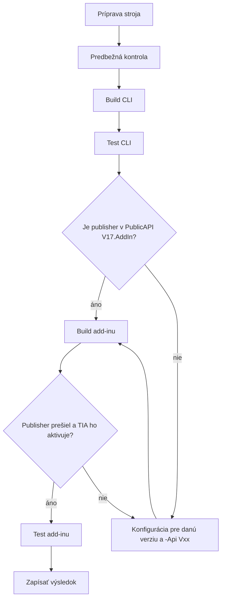

# Testovanie verzií TIA Portal

Cieľ: pred produkciou overiť každú používanú verziu na skutočnej inštalácii. Výsledky zapisujte sem a do [STATUS.md](STATUS.md).

## Matica verzií

| TIA | Dodávané Openness API | Odporúčaný CLI build | Add-in | .NET | Stav |
|---|---|---|---|---|---|
| V16 | V14 SP1, V15, V15.1, V16 | `V16` | nie je | 4.6.2 | ☐ neotestované |
| V17 | V15, V15.1, V16, V17 | `V17` | `V17` | 4.8 | ✅ overené |
| V18 | V15.1 až V18 | `V17` | `V18` | 4.8 | ✅ overené |
| V19 | V16 až V19 | `V17` | `V19` | 4.8 | ✅ overené |
| V20 | V17 až V20 | `V17` | `V20` | 4.8 | ✅ overené |
| V21 | V21 | `V21` | `V21` | 4.8 | ✅ overené |

API tabuľka vychádza z dokumentácie Openness 2019 až 2023 a z priečinkov overených vo V17 a V21. **Kompatibilita add-inu medzi verziami v dostupnej dokumentácii nie je opísaná.** Add-in preto treba otestovať na každej verzii.

## Postup



## Predbežná kontrola

Nastavte verziu a spustite vo VM:

```powershell
$v = 'V19'
Get-ChildItem "C:\Program Files\Siemens\Automation\Portal $v\PublicAPI" -Directory | Select-Object Name
Get-ChildItem "C:\Program Files\Siemens\Automation\Portal $v\PublicAPI" -Recurse -Filter "Siemens.Engineering.AddIn.Publisher.exe" | Select-Object FullName
Get-ChildItem HKLM:\SOFTWARE\Siemens\Automation\Openness | Select-Object PSChildName
whoami /groups | Select-String "Openness"
```

Výstup priložte k výsledku. Ukazuje skutočné API a umiestnenie publisheru.

Príprava stroja je v [02-setup-vyvoj.md](02-setup-vyvoj.md#príprava-novej-vm).

## Build

CLI pre TIA V18 až V20, príklad V19:

```powershell
powershell -ExecutionPolicy Bypass -File .\build.ps1 -Api V17 -Portal V19
```

Add-in (príklad V19, publisher je iba vo `V19.AddIn`):

```powershell
powershell -ExecutionPolicy Bypass -File .\build.ps1 -Api V19 -AddIn
```

TIA V16:

```powershell
powershell -ExecutionPolicy Bypass -File .\build.ps1 -Api V16
```

`build.ps1` pre V16 s `-AddIn` zámerne skončí chybou. Add-in V16 potrebuje vlastnú konfiguráciu podľa XSD z `PublicAPI\V16.AddIn`.

## Test CLI

Pri otvorenom projekte. Cesta platí pre build V17, pri V16 použite `V16\Release\net462`:

```powershell
.\src\TiaSbom.Cli\bin\V17\Release\net48\tiasbom.exe --attach --dump-hw --out sbom-test.json
```

Upload použite iba pre testovací projekt so skutočným kľúčom:

```powershell
$key = Read-Host "Kluc projektu"
.\src\TiaSbom.Cli\bin\V17\Release\net48\tiasbom.exe --attach --upload --key $key --out sbom-test.json
```

## Test add-inu

Pozri [nasadenie](02-setup-vyvoj.md#nasadenie-add-inu). Vždy zapíšte **Path** a **Version** z *Add-ins → Details*.

Po exporte:

```powershell
Get-Content "$env:APPDATA\TiaSbom\addin.log" -Tail 30
```

## Kontrolný zoznam pre jednu verziu

Skopírujte pre každú testovanú verziu do jej sekcie.

**Príprava**

- [ ] Skupina `Siemens TIA Openness`, nové prihlásenie.
- [ ] `config.json` a spojenie na Gitea.
- [ ] Predbežná kontrola uložená.

**CLI**

- [ ] Build bez chýb.
- [ ] `--attach` prejde a brána Openness je potvrdená.
- [ ] Počet zariadení sedí s projektom.
- [ ] CPU, moduly, panel a GSD majú číslo a firmvér.
- [ ] `tia:version` je skutočná verzia TIA.
- [ ] `tia:opennessApi` je použitý build.
- [ ] Výstup je čitateľný JSON.
- [ ] Multiuser projekt, ak sa vo firme používa.

**Add-in**

- [ ] Publisher prešiel.
- [ ] TIA add-in ukáže a aktivuje.
- [ ] Verzia v *Details* je očakávaná.
- [ ] Zapísaná cesta **Path**.
- [ ] Prvý export si vypýta token, ak nie je uložený.
- [ ] Okná sa zobrazia nad TIA.
- [ ] Pri prázdnom `Family` sa ukáže výber kľúča.
- [ ] Pri vyplnenom `Family` export prebehne bez dialógu.
- [ ] Nesprávny repozitár vyvolá varovanie.
- [ ] Druhá verzia tej istej zákazky s iným hardvérom nevyvolá varovanie a README ukáže obe.
- [ ] Zlý token ukáže chybu a ďalší export sa znova spýta.
- [ ] Nedostupná Gitea ukáže chybu, TIA nezamrzne natrvalo.
- [ ] Projekt zostane bez zmien.
- [ ] Neuložený projekt sa odmietne.
- [ ] Opakovaný export bez zmeny nič nezapíše.
- [ ] Zmena hardvéru pri rovnakom názve vytvorí `<názov>_2` a pôvodná verzia ostane.

**Gitea**

- [ ] Commit je v správnom repozitári.
- [ ] `latest.json`, `versions/...` a `README.md` sedia.
- [ ] Tag existuje.

## Výsledky

### TIA V21, overené

0.2.12, 2026-11-19, pilot proti **produkčnej Gitea** cez HTTPS (`tls internal`, `REQUIRE_SIGNIN_VIEW=true`). Build `-Api V21 -AddIn` z ZIP vetvy, `install.cmd -EnvFile` s `ADDIN_SCOPE=corporate` a `GITEA_CA_CERT`:

| Položka | Výsledok |
|---|---|
| Inštalácia | `CorporateAddIns\TiaSbom.V21.addin`, `config.json` bez servisného tokenu, kód 0 |
| `GITEA_CA_CERT` | koreňová CA Caddy pridaná, odtlačok v `install.log` |
| Test spojenia | *Gitea reachable …, version hidden because sign-in is required* |
| `tiasbom --login`, `check.cmd` | osobný token, všetky kroky OK, `RESULT: OK`, organizácia `sbom` prázdna |
| TIA | add-in aktivovaný, v kontextovom menu projektu je |
| Neoverené | export do produkčnej Gitea (zámerne zatiaľ nie), ESET na PC |

0.2.11, 2026-11-18, automatizovaný test cez SSH a interaktívnu plochu VM. Postup je v [12-automaticke-testy.md](12-automaticke-testy.md), screenshoty v [príručke](10-pouzivatelska-prirucka.md).

| Položka | Výsledok |
|---|---|
| Build | `-Api V21 -AddIn` OK, testy net48 vo VM OK |
| Balík a inštalácia | `package.ps1` + `install.ps1` s `ADDIN_SCOPE=corporate` OK, test spojenia OK |
| Path | `C:\ProgramData\Siemens\Automation\Portal V21\CorporateAddIns\TiaSbom.V21.addin` |
| Prvý štart TIA | Dialóg *Corporate Add-Ins updated – New Add-In added*, add-in deaktivovaný |
| Aktivácia | Status → Activate → *Add-in activation, Unsigned* → Yes → aktívny |
| Aktualizácia súboru | *Add-In replaced*, TIA add-in **deaktivuje**, treba znova aktivovať |
| Export | OK, dialóg kľúča pri prázdnom `Family`, nová verzia `_2`, odkaz na commit |
| Opakovaný export | *already stored*, nič sa nezapíše |
| `TS-NET-01`, `TS-NET-02`, `TS-NET-04` | správna hláška s kódom a cestou k logu |
| Token | dialóg nad TIA; zlý token `TS-AUTH-01`, token sa zmaže, v logu nie je |
| `check.cmd` s tokenom používateľa | OK |
| Chyba nájdená a opravená | okná add-inu sa otvárali za TIA, `MessageBox` bez ikony na paneli. Add-in na V21 beží vo vlastnom procese |
| Neoverené | neuložený projekt, archivovaný repozitár v TIA, vyplnené `Family`, multiuser, bežný používateľ |

0.2.10-rc1, 2026-11-06: `install.ps1 -Build` OK, starý `TiaSbom.addin` nahradený za `TiaSbom.V21.addin`, export do Gitea OK, používateľ potvrdil funkčnosť. Pri teste sa add-in raz zdal zaseknutý na hláške, príčina nie je potvrdená.


| Položka | Výsledok |
|---|---|
| Dátum, add-in | 2026-11-05, 0.2.6 |
| Build | `-Api V21 -AddIn` |
| Path | `%APPDATA%\Siemens\Automation\Portal V21\UserAddIns\TiaSbom.addin` |
| Dôvera | `fullTrust=True`, `UnrestrictedAccess` |
| Export | OK, 42 zariadení vrátane panelu Unified |
| Neoverené | multiuser, varovanie o zámene s novým kódom, zlyhanie tokenu |

### TIA V17, overené

0.2.11, 2026-11-19, `update-vm.cmd` z vetvy: inštalácia do `Portal V17\AddIns`, test spojenia OK, `check.cmd` `RESULT: OK`, Details 0.2.11, `fullTrust=False`. Dialóg čísla zákazky, okno „already stored“ a `TS-NET-04` (port 3999) sa ukázali **nad TIA** s ikonou **SBOM Export** na paneli úloh. Ctrl+C v okne hlásenia skopíruje text aj v sandboxe. Žiadna `SecurityException`. Test našiel chybu: `-Build` neinštaloval `check.cmd`, opravené. Neoverené: nový zápis verzie s 0.2.11, `TS-AUTH-01`.

0.2.10-rc1, 2026-11-06: `install.ps1 -Build` OK, sandbox OK, uložený token sa prečítal, rovnaký obsah sa nezapíše, tri verzie jednej zákazky sú oddelené, jeden commit na export. Neoverené: neuložený projekt, `<názov>_2`, zlý token.


| Položka | Výsledok |
|---|---|
| Dátum, add-in | 2026-11-05, 0.2.6 |
| Build | `-Api V17 -AddIn` |
| Path | `C:\Program Files\Siemens\Automation\Portal V17\AddIns\TiaSbom.V17.addin` |
| Dôvera | `fullTrust=False`, sandbox |
| Export | OK, 6 zariadení vrátane KTP700 |
| Neoverené | multiuser, varovanie o zámene s novým kódom, zlyhanie tokenu |

### TIA V18

0.2.11, 2026-11-19, `update-vm.cmd` z vetvy: inštalácia do `Portal V18\AddIns`, `check.cmd` a test spojenia OK, `fullTrust=False`. Podľa `addin.log` sa ukázal dialóg čísla zákazky, okno „already stored“ a `TS-NET-04` (port 3999), žiadna `SecurityException`. Neoverené: nový zápis verzie s 0.2.11, `TS-AUTH-01`. Publisher je iba vo `V18.AddIn`.

0.2.10-rc1, 2026-11-06: build `-Api V18 -AddIn` prešiel, používateľ potvrdil funkčnosť, dve nové verzie zapísané.

### TIA V19

0.2.11, 2026-11-19, `update-vm.cmd` z vetvy: inštalácia do `Portal V19\AddIns`, `check.cmd` aj test spojenia OK, Details 0.2.11, `fullTrust=False`. Dialóg čísla zákazky, okno „already stored“ a `TS-NET-04` (port 3999) sa ukázali **nad TIA** s ikonou **SBOM Export**, Ctrl+C skopíruje text. Žiadna `SecurityException`. Neoverené: nový zápis verzie s 0.2.11, `TS-AUTH-01`.

Starší priebeh od 2026-11-06:

| Položka | Výsledok |
|---|---|
| `PublicAPI` | `V16` až `V19`, ku každému `.AddIn`. Zhoduje sa s maticou |
| Register | `19.0` |
| CLI build | `-Api V17 -Portal V19` OK, bez Developer Packu 4.8 |
| `PublicAPI\V17.AddIn` | Add-In API a `Schemas`, **bez publisheru** |
| Publisher | iba `PublicAPI\V19.AddIn`, vo `V17.AddIn` nie je |
| CLI test | OK s buildom `V17` aj `V19`, 125 položiek, skutočná verzia TIA V19 |
| SBOM | Zariadenia Festo CMMT-ST sú od 0.2.7 v SBOM, overené. Bez čísla a firmvéru, hodnoty GSDML neposkytuje |
| Path | Skopírované do `C:\Program Files\Siemens\Automation\Portal V19\AddIns`, TIA odtiaľ add-in načítala |
| Dôvera | `fullTrust=False`, sandbox |
| Okná a čítanie | Dialóg tokenu, chybové okno a prečítanie projektu OK |
| Upload | OK, 2026-11-06, add-in 0.2.7 vytvoril nový repozitár, výsledok overený v Gitea |
| 0.2.10-rc1, 2026-11-06 | `install.ps1 -Build` OK. Rovnaký obsah sa nezapíše, neuložený projekt sa odmietne, tri verzie jednej zákazky sú oddelené, jeden export je jeden commit, tagy aj README sedia |
| Neoverené | `<názov>_2`, „Save as“, výpadok siete, archivovaný repozitár, zlý token, súbežný export, multiuser, vyplnené `Family` |
| Schéma | Namespace `.../Publisher/V19`, dovoľuje `SecurityPermissions` aj `UnrestrictedPermissions` |
| Add-in | `-Api V19 -AddIn`, 0.2.7, balík sa aktivuje a beží |

Pozornosť: `Device.UnpluggedItems` je od V19 dokumentované.

### TIA V20

0.2.11, 2026-11-19, `update-vm.cmd` z vetvy: inštalácia do `Portal V20\AddIns`, `check.cmd` a test spojenia OK, `fullTrust=False`. Podľa `addin.log` sa ukázal dialóg čísla zákazky, okno „already stored“ a `TS-NET-04` (port 3999), žiadna `SecurityException`. Neoverené: nový zápis verzie s 0.2.11, `TS-AUTH-01`. 0.2.10 z 2026-11-12 zapísala novú verziu. Prvý build 2026-11-06 zlyhal, opakovaný prešiel, príčina nie je zapísaná.

### TIA V16

Neotestované. Build V16 nebol ani raz zostavený. `tia:unpluggedItemsRead` je `false`, chýba `ProjectBase` a multiuser. Add-in nie je pripravený.

## Čo robiť pri zlyhaní

| Príznak | Krok |
|---|---|
| `Openness API ... not found` | Skontrolujte `PublicAPI` a použite `-Portal` |
| Chyba publisheru | Porovnajte XSD a konfiguráciu, pošlite výstup |
| Add-in sa neaktivuje | Text chyby a výstup predbežnej kontroly |
| `SecurityException` | `addin.log`, pozri [sandbox](06-kod.md#sandbox-v17) |
| Chýbajúce zariadenie | `--dump-hw` a jeho riadky |

Pri novej chybe doplňte [08-riesenie-problemov.md](08-riesenie-problemov.md).

## Testy výnimiek

Stačí ich prejsť raz na V17, V19 a V21. Každá chyba musí povedať, čo sa stalo a čo robiť. Väčšinu logiky už overujú [automatické testy](12-automaticke-testy.md) bez TIA. V TIA ostáva overiť, že sa hláška ukáže a TIA nezamrzne.

| Test | Očakávaný výsledok | Automatický test | V21 v TIA |
|---|---|---|---|
| Neuložený projekt | Export sa zastaví, výzva na uloženie | áno | – |
| Projekt bez hardvéru | Export sa zastaví | áno | – |
| Export bez zmeny | Správa, že obsah už existuje, žiadny nový commit | áno, Gitea | ✅ 2026-11-18 |
| Zmena hardvéru pri rovnakom názve | `<názov>_2`, pôvodná verzia ostane | áno, Gitea | ✅ 2026-11-18 |
| Dve verzie s iným hardvérom a iným názvom | Bez varovania, README ukáže obe | áno | – |
| „Save as“ s novým číslom a starým `Family` | Varovanie o čísle zákazky | áno | – |
| Nový nečíselný kľúč s preklepom | Varovanie o podobnom repozitári | áno | – |
| Názov s diakritikou | `Čiara` sa uloží ako `Ciara` | áno | – |
| Názov dlhší ako 100 znakov | Skrátený názov s hashom | áno | – |
| Archivovaný repozitár | `TS-GIT-03`, `token.bin` ostane | áno, Gitea | – |
| Zlý token | `TS-AUTH-01`, výzva na nový token | áno, Gitea | ✅ 2026-11-18 |
| Token bez oprávnení | `TS-AUTH-02` s návodom | áno, Gitea | – |
| Vypnutá Gitea, zlý port, zlé meno | `TS-NET-02`, `TS-NET-04`, `TS-NET-01`, TIA nezamrzne | áno | ✅ 2026-11-18 |
| HTML namiesto API | `TS-API-01` | áno | – |
| Certifikát | `TS-TLS-01` | áno, aj inštalátor | – |
| Dvaja exportujú naraz | Oba exporty sú v Gitea a v README | áno, 4 súbežne, Gitea | – |
| `config.json` chýba alebo je poškodený | `TS-CFG-01`, `TS-CFG-02` | áno | – |
