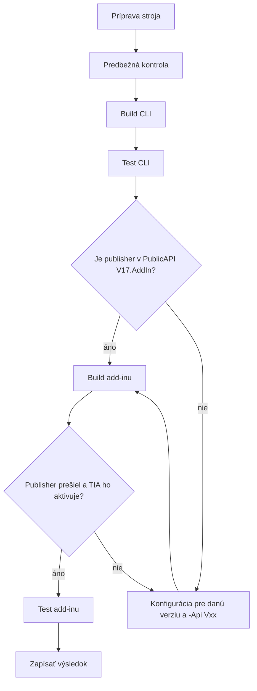

# Testovanie verzií TIA Portal

Cieľ: pred produkciou overiť každú používanú verziu na skutočnej inštalácii. Výsledky zapisujte sem a do [STATUS.md](STATUS.md).

## Matica verzií

| TIA | Dodávané Openness API | Odporúčaný CLI build | Add-in | .NET | Stav |
|---|---|---|---|---|---|
| V16 | V14 SP1, V15, V15.1, V16 | `V16` | nie je | 4.6.2 | ☐ neotestované |
| V17 | V15, V15.1, V16, V17 | `V17` | `V17` | 4.8 | ✅ overené |
| V18 | V15.1 až V18 | `V17` | neznáme | 4.8 | ☐ neotestované |
| V19 | V16 až V19 | `V17` | `V19` | 4.8 | ✅ overené |
| V20 | V17 až V20 | `V17` | neznáme | 4.8 | ☐ neotestované |
| V21 | V21 | `V21` | `V21` | 4.8 | ✅ overené |

API tabuľka vychádza z dokumentácie Openness 2019 až 2023 a z priečinkov overených vo V17 a V21. **Kompatibilita add-inu medzi verziami v dostupnej dokumentácii nie je opísaná.** Add-in preto treba otestovať na každej verzii.

## Postup



## Predbežná kontrola

Nastavte verziu a spustite vo VM:

```powershell
$v = 'V19'
Get-ChildItem "C:\Program Files\Siemens\Automation\Portal $v\PublicAPI" -Directory | Select-Object Name
Get-ChildItem "C:\Program Files\Siemens\Automation\Portal $v\PublicAPI" -Recurse -Filter "Siemens.Engineering.AddIn.Publisher.exe" | Select-Object FullName
Get-ChildItem HKLM:\SOFTWARE\Siemens\Automation\Openness | Select-Object PSChildName
whoami /groups | Select-String "Openness"
```

Výstup priložte k výsledku. Ukazuje skutočné API a umiestnenie publisheru.

Príprava stroja je v [02-setup-vyvoj.md](02-setup-vyvoj.md#príprava-novej-vm).

## Build

CLI pre TIA V18 až V20, príklad V19:

```powershell
powershell -ExecutionPolicy Bypass -File .\build.ps1 -Api V17 -Portal V19
```

Add-in (príklad V19, publisher je iba vo `V19.AddIn`):

```powershell
powershell -ExecutionPolicy Bypass -File .\build.ps1 -Api V19 -AddIn
```

TIA V16:

```powershell
powershell -ExecutionPolicy Bypass -File .\build.ps1 -Api V16
```

`build.ps1` pre V16 s `-AddIn` zámerne skončí chybou. Add-in V16 potrebuje vlastnú konfiguráciu podľa XSD z `PublicAPI\V16.AddIn`.

## Test CLI

Pri otvorenom projekte. Cesta platí pre build V17, pri V16 použite `V16\Release\net462`:

```powershell
.\src\TiaSbom.Cli\bin\V17\Release\net48\tiasbom.exe --attach --dump-hw --out sbom-test.json
```

Upload použite iba pre testovací projekt so skutočným kľúčom:

```powershell
$key = Read-Host "Kluc projektu"
.\src\TiaSbom.Cli\bin\V17\Release\net48\tiasbom.exe --attach --upload --key $key --out sbom-test.json
```

## Test add-inu

Pozri [nasadenie](02-setup-vyvoj.md#nasadenie-add-inu). Vždy zapíšte **Path** a **Version** z *Add-ins → Details*.

Po exporte:

```powershell
Get-Content "$env:APPDATA\TiaSbom\addin.log" -Tail 30
```

## Kontrolný zoznam pre jednu verziu

Skopírujte pre každú testovanú verziu do jej sekcie.

**Príprava**

- [ ] Skupina `Siemens TIA Openness`, nové prihlásenie.
- [ ] `config.json` a spojenie na Gitea.
- [ ] Predbežná kontrola uložená.

**CLI**

- [ ] Build bez chýb.
- [ ] `--attach` prejde a brána Openness je potvrdená.
- [ ] Počet zariadení sedí s projektom.
- [ ] CPU, moduly, panel a GSD majú číslo a firmvér.
- [ ] `tia:version` je skutočná verzia TIA.
- [ ] `tia:opennessApi` je použitý build.
- [ ] Výstup je čitateľný JSON.
- [ ] Multiuser projekt, ak sa vo firme používa.

**Add-in**

- [ ] Publisher prešiel.
- [ ] TIA add-in ukáže a aktivuje.
- [ ] Verzia v *Details* je očakávaná.
- [ ] Zapísaná cesta **Path**.
- [ ] Prvý export si vypýta token, ak nie je uložený.
- [ ] Okná sa zobrazia nad TIA.
- [ ] Pri prázdnom `Family` sa ukáže výber kľúča.
- [ ] Pri vyplnenom `Family` export prebehne bez dialógu.
- [ ] Nesprávny repozitár vyvolá varovanie.
- [ ] Zlý token ukáže chybu a ďalší export sa znova spýta.
- [ ] Nedostupná Gitea ukáže chybu, TIA nezamrzne natrvalo.
- [ ] Projekt zostane bez zmien.

**Gitea**

- [ ] Commit je v správnom repozitári.
- [ ] `latest.json`, `versions/...` a `README.md` sedia.
- [ ] Tag existuje.

## Výsledky

### TIA V21, overené

| Položka | Výsledok |
|---|---|
| Dátum, add-in | 2026-11-05, 0.2.6 |
| Build | `-Api V21 -AddIn` |
| Path | `%APPDATA%\Siemens\Automation\Portal V21\UserAddIns\TiaSbom.addin` |
| Dôvera | `fullTrust=True`, `UnrestrictedAccess` |
| Export | OK, 42 zariadení vrátane panelu Unified |
| Neoverené | multiuser, varovanie o zámene s novým kódom, zlyhanie tokenu |

### TIA V17, overené

| Položka | Výsledok |
|---|---|
| Dátum, add-in | 2026-11-05, 0.2.6 |
| Build | `-Api V17 -AddIn` |
| Path | `C:\Program Files\Siemens\Automation\Portal V17\AddIns\TiaSbom.V17.addin` |
| Dôvera | `fullTrust=False`, sandbox |
| Export | OK, 6 zariadení vrátane KTP700 |
| Neoverené | multiuser, varovanie o zámene s novým kódom, zlyhanie tokenu |

### TIA V18

Neotestované. Kľúčové otázky: existuje `PublicAPI\V17.AddIn`? Dá sa balík aktivovať? Vyžaduje CLI licenčné ošetrenie `LicenseNotFoundException`, ktorá je k dispozícii od V18?

### TIA V19

Prebieha, začiatok 2026-11-06.

| Položka | Výsledok |
|---|---|
| `PublicAPI` | `V16` až `V19`, ku každému `.AddIn`. Zhoduje sa s maticou |
| Register | `19.0` |
| CLI build | `-Api V17 -Portal V19` OK, bez Developer Packu 4.8 |
| `PublicAPI\V17.AddIn` | Add-In API a `Schemas`, **bez publisheru** |
| Publisher | iba `PublicAPI\V19.AddIn`, vo `V17.AddIn` nie je |
| CLI test | OK s buildom `V17` aj `V19`, 125 položiek, skutočná verzia TIA V19 |
| SBOM | Zariadenia Festo CMMT-ST sú od 0.2.7 v SBOM, overené. Bez čísla a firmvéru, hodnoty GSDML neposkytuje |
| Path | Skopírované do `C:\Program Files\Siemens\Automation\Portal V19\AddIns`, TIA odtiaľ add-in načítala |
| Dôvera | `fullTrust=False`, sandbox |
| Okná a čítanie | Dialóg tokenu, chybové okno a prečítanie projektu OK |
| Upload | OK, 2026-11-06, add-in 0.2.7 vytvoril nový repozitár, výsledok overený v Gitea |
| Neoverené | multiuser, vyplnené `Family`, varovanie o zámene, zlyhanie tokenu |
| Schéma | Namespace `.../Publisher/V19`, dovoľuje `SecurityPermissions` aj `UnrestrictedPermissions` |
| Add-in | `-Api V19 -AddIn`, 0.2.7, balík sa aktivuje a beží |

Pozornosť: `Device.UnpluggedItems` je od V19 dokumentované.

### TIA V20

Neotestované. Pozornosť: najnovší build, ktorý ešte podporuje API V17.

### TIA V16

Neotestované. Build V16 nebol ani raz zostavený. `tia:unpluggedItemsRead` je `false`, chýba `ProjectBase` a multiuser. Add-in nie je pripravený.

## Čo robiť pri zlyhaní

| Príznak | Krok |
|---|---|
| `Openness API ... not found` | Skontrolujte `PublicAPI` a použite `-Portal` |
| Chyba publisheru | Porovnajte XSD a konfiguráciu, pošlite výstup |
| Add-in sa neaktivuje | Text chyby a výstup predbežnej kontroly |
| `SecurityException` | `addin.log`, pozri [sandbox](06-kod.md#sandbox-v17) |
| Chýbajúce zariadenie | `--dump-hw` a jeho riadky |

Pri novej chybe doplňte [08-riesenie-problemov.md](08-riesenie-problemov.md).
