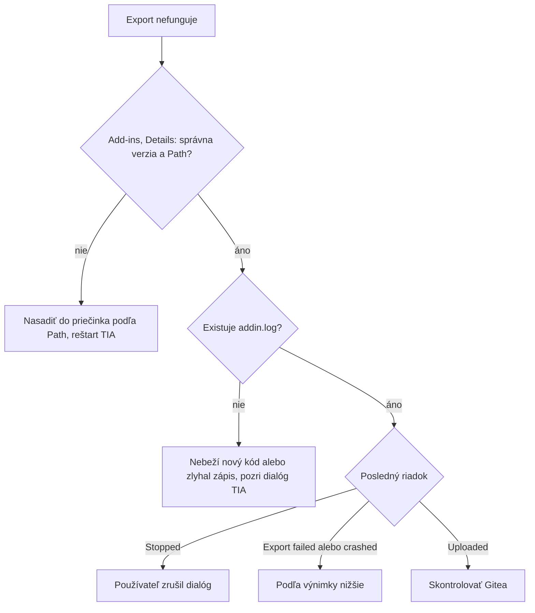

# Riešenie problémov

Každá položka vznikla pri skutočnom testovaní. Nové chyby dopisujte sem.

## Prvá diagnostika



```powershell
Get-Content "$env:APPDATA\TiaSbom\addin.log" -Tail 30
```

## Nasadenie a build

| Príznak | Príčina | Riešenie |
|---|---|---|
| Po zmene kódu sa nič nemení, v Details je stará verzia | Add-in je v inom priečinku, než TIA číta | Riadiť sa **Path** v Details |
| `.addin` má rovnakú dĺžku po zmene kódu | ZIP je starý, alebo sa preklad preskočil | Skontrolovať čas ZIP-u a `<Version>`. `build.ps1` má `--no-incremental` |
| `Test-Path` v starom priečinku vráti `False` | ZIP vetvy `main` sa rozbalí do `tia-sbom-utility-main` | Prejsť do správneho priečinka |
| `The argument '.\build.ps1' ... does not exist` | Príkaz beží v `system32` | `cd` do `TiaSbom` |
| Skript nejde spustiť | Execution Policy | `powershell -ExecutionPolicy Bypass -File ...` |
| `Illegal characters in path` | V príkaze ostal zástupný text | Doplniť skutočnú cestu |
| `CS0433` duplicitné typy | Pred V21 sa bije Add-In API so `Siemens.Engineering.dll` | Odkazovať len Add-In API, pozri [kód](06-kod.md#závislosti-projektov) |
| Publisher: `SbomContextMenu should be public` | Interný typ | Typy odvodené z `AddIn` musia byť `public` |
| `dotnet` sa nenašiel | Starý `PATH` | Otvoriť nové okno PowerShellu |
| `MSB3644`, chýba `v4.8` | Chýbajú referenčné zostavenia a NuGet nie je dostupný | Povoliť internet pri builde alebo nainštalovať .NET Framework 4.8 Developer Pack |
| V `src` chýba `TiaSbom.AddIn` | Stará kópia kódu | Stiahnuť ZIP z `main` a skontrolovať `<Version>` |
| Chyba pri buildovaní zo zlej cesty | Priečinok `src` namiesto `TiaSbom` | Spustiť z `TiaSbom` |

## Add-in

| Príznak | Príčina | Riešenie |
|---|---|---|
| `SecurityException: Request failed`, `LinkDemand`, `PermissionSet` | Kód volá API vyžadujúce plnú dôveru | Pozri [sandbox](06-kod.md#sandbox-v17) |
| `The type initializer for System.Text.Json...` | NuGet závislosti v procese TIA | Žiadne NuGet balíky |
| `set_Text ... read-only context` | `TIA.ReadOnly` nedovoľuje meniť text `ExclusiveAccess` | Pre každú fázu nový `ExclusiveAccess` |
| Okno nie je vidieť | Dialóg bez vlastníka môže skončiť za TIA | `Ui.Run` s topmost vlastníkom |
| Token sa odmieta | Gitea vrátila 401 alebo 403 | Vytvoriť nový s oprávneniami podľa [tokenov](03-gitea-server.md#tokeny) |
| Ticho bez výsledku po kliknutí | Stará verzia v Details | Prvá diagnostika |

## CLI a Openness

| Príznak | Príčina | Riešenie |
|---|---|---|
| Príkaz visí | Brána Openness čaká v TIA | Prepnúť sa do TIA a potvrdiť |
| Bezpečnostná chyba alebo odmietnutý prístup | Používateľ nie je v skupine | `net localgroup "Siemens TIA Openness"`, nové prihlásenie |
| `Already a member`, ale chyba trvá | Členstvo platí až po prihlásení | Odhlásiť sa |
| `No running TIA Portal found` | Rozdielne práva procesov | TIA a CLI spúšťať s rovnakými právami |
| `Several TIA Portal versions are running` | Beží viac verzií | `--portal Vxx` |
| `Project has no Family` | Chýba kľúč | `--key` alebo vyplniť Family |
| `Refusing to upload` | Podozrenie na zámenu | Skontrolovať cieľ, `--force` iba pri istote |

## SBOM

| Príznak | Príčina | Riešenie |
|---|---|---|
| Chýba panel HMI | Panel nemá atribút `OrderNumber`, je len v `TypeIdentifier` | Opravené, `--dump-hw` ukáže stav |
| Vo výpise je `Rack` ako produkt | Stojan S7-1200 má číslo `Rack` | `IsProduct` |
| Firmvér `V0.0` | Pasívny modul | Berie sa ako bez firmvéru |
| `IsGsd` je `false` | Atribút je nespoľahlivý | Používa sa `TypeIdentifier` |
| `IV3-XXXX` | Hodnota z GSDML | Známe obmedzenie |

Výpis položiek:

```powershell
.\src\TiaSbom.Cli\bin\V17\Release\net48\tiasbom.exe --attach --dump-hw --out sbom-test.json
```

## Gitea a sieť

| Príznak | Príčina | Riešenie |
|---|---|---|
| `An error occurred while sending the request`, timeout | Zlá adresa v `config.json`, alebo beží mimo WSL | [Adresa prepínača](03-gitea-server.md#zmena-adresy-prepínača) |
| Vo VM zlyhá `Test-NetConnection` | WSL nebeží, zmenila sa adresa, VM je na inom prepínači | Spustiť WSL, skontrolovať `portproxy` a sieť VM |
| Prihlásenie na web nič neurobí | Otvorené cez HTTP | Použiť `https://localhost` |
| `403 ... required scope` | Slabý token | Pridať oprávnenia organization a repository |
| `404` pri organizácii | Organizácia neexistuje | Vytvoriť `sbom` |
| Varovanie certifikátu | `tls internal` | Vo vývoji očakávané |
| Docker kontajner nebeží | WSL sa vypol alebo zlyhal štart | `wsl -d Ubuntu-26.04`, potom `docker compose ps` |

## Hyper-V a prenos

| Príznak | Riešenie |
|---|---|
| Ctrl+C a Ctrl+V nefunguje | Hyper-V **View → Enhanced Session** |
| `\\tsclient\C`: Access denied | Spúšťať bez práv správcu alebo cez prieskumník |
| `\\tsclient` nie je | Enhanced Session a lokálne zdroje |
| `%USERNAME%` sa v PowerShelli nerozbalí | Použiť `$env:USERNAME` |
| Kopírovanie cez GitHub | Vo VM sa prihlásiť na GitHub, súkromný repozitár inak ukazuje 404 |
| Staré ZIP súbory | Vybrať najnovší podľa `LastWriteTime` a skontrolovať čas |

## Git

| Príznak | Príčina | Riešenie |
|---|---|---|
| Kód add-inu nie je na GitHube | `*.addin` zodpovedá priečinku `TiaSbom.AddIn` | Výnimka `!src/TiaSbom.AddIn/` v `.gitignore` |
| Commit obsahuje cudzie zmeny | V indexe boli staged súbory používateľa | `git commit -- <súbory>` |
| Push išiel na inú vetvu | Vetva sa medzitým zmenila | Vždy `git branch --show-current` pred pushom |
