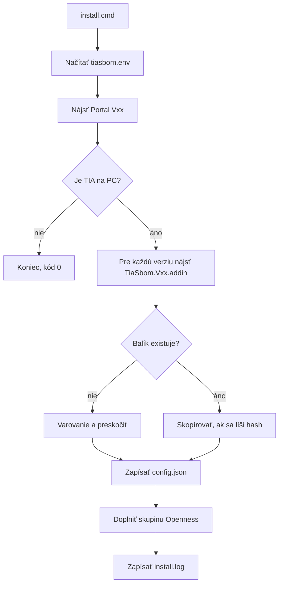
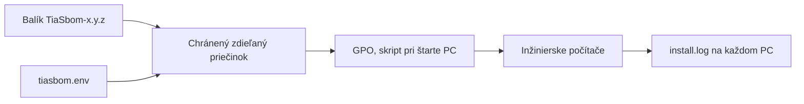

# Inštalácia a hromadné nasadenie

Inštalátor nasadí add-in pre každú verziu TIA nájdenú na počítači a zapíše konfiguráciu. Dá sa spúšťať opakovane: zmení len to, čo sa zmenilo.

| Súbor | Účel |
|---|---|
| `TiaSbom/deploy/install.ps1` | Inštalácia, kontrola, odinštalovanie |
| `TiaSbom/deploy/install.cmd` | Spustenie bez ohľadu na Execution Policy |
| `TiaSbom/deploy/tiasbom.env.example` | Šablóna nastavení |
| `TiaSbom/deploy/package.ps1` | Zloženie balíka pre nasadenie |

## Stav overenia

| Oblasť | Stav |
|---|---|
| Logika inštalátora | Overená na falošnej inštalácii TIA: kontrola, inštalácia, opakovanie, odstránenie starého súboru, odinštalovanie |
| Skutočné TIA | **Neoverené** |
| GPO a účet SYSTEM | **Neoverené** |
| `package.ps1` | Overené na falošných súboroch |
| Automatická aktivácia add-inu | **Inštalátor ju nerobí**, pozri [obmedzenia](#obmedzenia) |

## Ako to funguje



Balík pre inú verziu TIA sa nikdy nepoužije. Starý súbor `TiaSbom*.addin` v tom istom priečinku sa odstráni, inak by sa v TIA zobrazil dvakrát.

## Nastavenia

Skopírujte `tiasbom.env.example` na `tiasbom.env` vedľa `install.ps1`. Súbor je v `.gitignore`.

| Kľúč | Povinný | Význam |
|---|---|---|
| `GITEA_BASE_URL` | áno | Adresa Gitea |
| `GITEA_OWNER` | áno | Organizácia, `sbom` |
| `GITEA_BRANCH` | nie | Vetva, predvolene `main` |
| `GITEA_PRIVATE_REPOS` | nie | `true` alebo `false` |
| `GITEA_TIMEOUT_SECONDS` | nie | Predvolene 60 |
| `GITEA_TOKEN` | nie | Servisný token, čitateľný pre používateľov PC |
| `OPENNESS_MEMBERS` | nie | Účty pre skupinu `Siemens TIA Openness`, oddelené čiarkou |
| `TIA_ROOT` | nie | Koreň inštalácie TIA |
| `ADDIN_DIR_Vnn` | nie | Priečinok add-inu pre verziu, napríklad `ADDIN_DIR_V21` |

Zmena nastavenia: upravte `tiasbom.env` a znova spustite inštalátor.

Predvolené priečinky:

| TIA | Priečinok |
|---|---|
| V17, V19 | `<TIA_ROOT>\Portal Vnn\AddIns` |
| V21 | `%APPDATA%\Siemens\Automation\Portal V21\UserAddIns` |
| ostatné | `<TIA_ROOT>\Portal Vnn\AddIns`, treba overiť |

## Použitie na jednom počítači

Vo VM, v PowerShelli ako správca, v `TiaSbom`:

```powershell
Copy-Item .\deploy\tiasbom.env.example .\deploy\tiasbom.env -ErrorAction SilentlyContinue
notepad .\deploy\tiasbom.env
```

Pred zápisom skontrolujte plán, nič sa tým nezmení:

```powershell
powershell -ExecutionPolicy Bypass -File .\deploy\install.ps1 -Check
```

Zostavenie a nasadenie v jednom kroku:

```powershell
powershell -ExecutionPolicy Bypass -File .\deploy\install.ps1 -Build
```

Odinštalovanie:

```powershell
powershell -ExecutionPolicy Bypass -File .\deploy\install.ps1 -Uninstall
```

Odinštalovanie necháva `token.bin`, `addin.log`, `install.log` a členstvo v skupine.

Výsledok je v `%ProgramData%\TiaSbom\install.log`.

| Kód | Význam |
|---|---|
| 0 | Hotovo alebo na PC nie je TIA |
| 1 | Chyba |
| 2 | TIA je, ale chýba balík pre všetky jej verzie |

## Balík pre nasadenie

Add-in sa dá zostaviť iba na stroji s danou verziou TIA. Na každej VM:

```powershell
powershell -ExecutionPolicy Bypass -File .\build.ps1 -Api V19 -AddIn
powershell -ExecutionPolicy Bypass -File .\deploy\package.ps1
```

`-Api` zvoľte podľa verzie TIA. Ďalšie balíky pridajte z priečinka so súbormi z ostatných VM:

```powershell
powershell -ExecutionPolicy Bypass -File .\deploy\package.ps1 -AddInFolder C:\Temp\addins
```

Výsledok je `dist\TiaSbom-<verzia>\` a ZIP. `tiasbom.env` v ňom zámerne nie je.

## Nasadenie na 70 počítačov



Odporúčané je Active Directory GPO. Je súčasťou Windows, nič sa nekupuje. Postup treba pripraviť s IT:

1. Priečinok `\\server\share\TiaSbom` dostane balík a `tiasbom.env`.
2. Čítať smie iba **Domain Computers** a správcovia, zapisovať iba správcovia.
3. GPO: **Computer Configuration → Policies → Windows Settings → Scripts → Startup**, skript `\\server\share\TiaSbom\install.cmd`.
4. Skript beží ako SYSTEM pri štarte počítača. Pre V21 nastavte `ADDIN_DIR_V21`, lebo `%APPDATA%` tam nie je dostupný.
5. Začnite pilotom na 2 až 3 počítačoch v skúšobnej OU.
6. Nová verzia sa nasadí výmenou súborov, počítače sa aktualizujú pri ďalšom štarte.

### Kontrola nasadenia

Na jednom počítači:

```powershell
Get-Content "$env:ProgramData\TiaSbom\install.log" -Tail 15
```

## Obmedzenia

Pred veľkým nasadením treba overiť:

1. **Aktivácia:** TIA doteraz vyžadovala, aby používateľ add-in aktivoval v záložke *Add-ins*. Inštalátor to nerobí. Treba zistiť, či to platí aj pre *Corporate Add-Ins* a podpísaný balík. Inak zostane jeden ručný krok na používateľa.
2. **V21 pre všetkých:** Overený je iba priečinok používateľa. Pre celý počítač treba overiť `CorporateAddIns` a nastaviť `ADDIN_DIR_V21`.
3. **V18, V20, V16:** Zatiaľ nemajú balík, inštalátor ich preskočí s varovaním.
4. **Token:** Pri servisnom tokene ho prečíta každý používateľ počítača. `config.json` dostane práva len na čítanie. Bez tokenu si ho každý zadá raz sám.
5. **Bežiaca TIA:** Súbor sa prepíše, ale TIA ho načíta až po reštarte.

## Bezpečnosť

- `tiasbom.env` s tokenom sa nikdy neukladá do Gitu.
- Log neobsahuje hodnotu tokenu.
- Inštalátor nemení firewall ani sieť.
- `OPENNESS_MEMBERS` dáva členom prístup k TIA cez Openness, uvádzajte len nutné skupiny.
- Produkčný `GITEA_BASE_URL` používa `https://`, inštalátor pri HTTP varuje.
