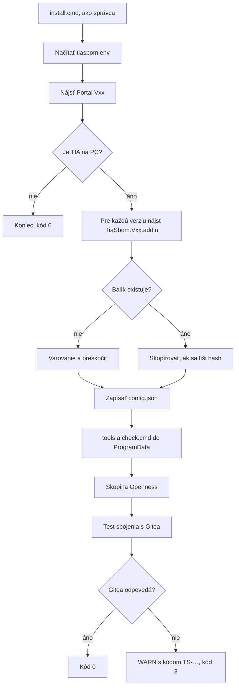
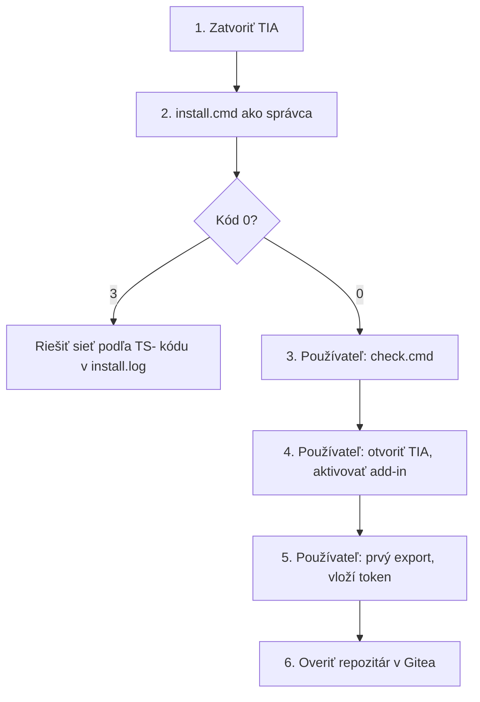
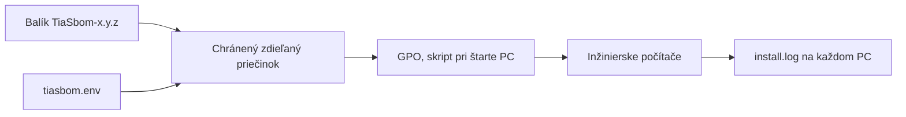

# Inštalácia a hromadné nasadenie

Inštalátor nasadí add-in pre každú verziu TIA nájdenú na počítači, zapíše konfiguráciu a **otestuje spojenie s Gitea**. Dá sa spúšťať opakovane: zmení len to, čo sa zmenilo.

Používateľský postup (aktivácia, export, hlášky) je v [10-pouzivatelska-prirucka.md](10-pouzivatelska-prirucka.md).

| Súbor | Účel |
|---|---|
| `TiaSbom/deploy/install.ps1` | Inštalácia, kontrola, odinštalovanie, test spojenia |
| `TiaSbom/deploy/install.cmd` | Spustenie bez ohľadu na Execution Policy |
| `TiaSbom/deploy/check.cmd` | Kontrola spojenia pre používateľa, bez práv správcu |
| `TiaSbom/deploy/tiasbom.env.example` | Šablóna nastavení |
| `TiaSbom/deploy/package.ps1` | Zloženie balíka pre nasadenie |
| `TiaSbom/deploy/update-vm.cmd` | Iba vývoj, rýchla aktualizácia VM |

## Stav overenia

| Oblasť | Stav |
|---|---|
| Inštalácia na TIA V21 s `ADDIN_SCOPE=corporate` | **Overené 2026-11-18** na VM s TIA V21, add-in 0.2.11 |
| TIA zobrazí nový add-in v *Corporate Add-Ins* bez služby Rollout | **Overené** na V21 |
| Aktualizácia add-inu | **Overené** na V21: TIA ho vymení a **deaktivuje**, používateľ ho musí znova aktivovať |
| Test spojenia v inštalátore | **Overené** na V21 a v PowerShelli 5.1 na laptope: OK, `TS-NET-01`, `TS-NET-02`, `TS-NET-04`, `TS-TLS-01`, `TS-AUTH-03` |
| `check.cmd` s osobným tokenom používateľa | **Overené** na V21 |
| `package.ps1` s nástrojmi a `check.cmd` | **Overené** na V21 |
| V17 a V19, priečinok v inštalácii TIA | Overené skôr na falošnej inštalácii, na TIA iba ručné kopírovanie |
| GPO a účet SYSTEM | **Neoverené** |
| Bežný používateľ bez práv správcu | **Neoverené** |

## Ako to funguje



Balík pre inú verziu TIA sa nikdy nepoužije. Starý súbor `TiaSbom*.addin` v tom istom priečinku sa odstráni, inak by sa v TIA zobrazil dvakrát.

## Nastavenia

Skopírujte `tiasbom.env.example` na `tiasbom.env` vedľa `install.ps1`. Súbor je v `.gitignore`.

| Kľúč | Povinný | Význam |
|---|---|---|
| `GITEA_BASE_URL` | áno | Adresa Gitea, napríklad `https://gitea.firma.local` |
| `GITEA_OWNER` | áno | Organizácia, `sbom` |
| `GITEA_BRANCH` | nie | Vetva, predvolene `main` |
| `GITEA_PRIVATE_REPOS` | nie | `true` alebo `false` |
| `GITEA_TIMEOUT_SECONDS` | nie | 1 až 600, predvolene 60 |
| `GITEA_TOKEN` | nie | Servisný token, čitateľný pre používateľov PC |
| `OPENNESS_MEMBERS` | nie | Účty pre skupinu `Siemens TIA Openness`, oddelené čiarkou |
| `ADDIN_SCOPE` | nie | `corporate`: V21 pre všetkých používateľov PC. Prázdne: priečinok používateľa, ktorý inštaluje |
| `TIA_ROOT` | nie | Koreň inštalácie TIA |
| `ADDIN_DIR_Vnn` | nie | Priečinok add-inu pre verziu, má prednosť pred `ADDIN_SCOPE` |

Zmena nastavenia: upravte `tiasbom.env` a znova spustite inštalátor.

Priečinky add-inu:

| TIA | `ADDIN_SCOPE=corporate` | bez `ADDIN_SCOPE` | Overené |
|---|---|---|---|
| V17, V19 | `<TIA_ROOT>\Portal Vnn\AddIns` | rovnaké | áno |
| V21 | `C:\ProgramData\Siemens\Automation\Portal V21\CorporateAddIns` | `%APPDATA%\Siemens\Automation\Portal V21\UserAddIns` | áno, obe |
| V18, V20 | `<TIA_ROOT>\Portal Vnn\AddIns` | rovnaké | nie |

**Pre viac používateľov na jednom PC vždy použite `ADDIN_SCOPE=corporate`.** Bez neho dostane add-in iba účet, ktorý inštaloval. Priečinok `CorporateAddIns` uvádza [dokumentácia Siemens pre V21](https://docs.tia.siemens.cloud/r/it-it/v21/introduzione-al-tia-portal/ampliamento-delle-funzioni-di-tia-portal-tramite-add-ins/nozioni-di-base-sugli-add-ins). Overili sme, že TIA berie add-in zapísaný priamo inštalátorom, aj keď služba *Siemens Add-In Rollout Service* nebeží.

## Použitie na jednom počítači

Spustite v PowerShelli ako správca, v rozbalenom balíku:

```powershell
Copy-Item .\tiasbom.env.example .\tiasbom.env -ErrorAction SilentlyContinue
notepad .\tiasbom.env
```

Pred zápisom skontrolujte plán. Nič sa tým nezmení:

```powershell
powershell -ExecutionPolicy Bypass -File .\install.ps1 -Check
```

Inštalácia:

```powershell
powershell -ExecutionPolicy Bypass -File .\install.ps1
```

Vo vývoji, s buildom pre nainštalovanú TIA:

```powershell
powershell -ExecutionPolicy Bypass -File .\deploy\install.ps1 -Build
```

Odinštalovanie:

```powershell
powershell -ExecutionPolicy Bypass -File .\install.ps1 -Uninstall
```

Odinštalovanie odstráni add-in, `config.json`, `tools` a `check.cmd`. Nechá `token.bin`, `addin.log`, `install.log` a členstvo v skupine.

Výsledok je v `%ProgramData%\TiaSbom\install.log`:

| Kód | Význam |
|---|---|
| 0 | Hotovo, Gitea dostupná, alebo na PC nie je TIA |
| 1 | Chyba, dôvod je v riadku `ERROR` |
| 2 | TIA je, ale chýba balík pre všetky jej verzie |
| 3 | Nainštalované, ale Gitea z tohto PC nie je dostupná. Riadok `WARN Connection test TS-…` uvádza kód z [11-chybove-hlasky.md](11-chybove-hlasky.md) |

Príklad úspešnej inštalácie na V21:

```text
INFO  Install on <PC>, TIA: V21
INFO  V21: installed C:\ProgramData\Siemens\Automation\Portal V21\CorporateAddIns\TiaSbom.V21.addin
WARN  GITEA_BASE_URL uses plain HTTP, the token travels unencrypted
INFO  Wrote C:\ProgramData\TiaSbom\config.json (http://<gitea>:3000, owner sbom, service token: no)
INFO  Tools: C:\ProgramData\TiaSbom\tools, users run C:\ProgramData\TiaSbom\check.cmd
INFO  Connection test: Gitea 28.2.0 reachable at http://<gitea>:3000
INFO  Connection test: no service token, each user enters a personal token at the first export
INFO  Finished: 1 of 1 TIA versions, 1 warnings
```

Varovanie o HTTP zmizne s produkčnou adresou `https://`.

## Balík pre nasadenie

Add-in sa dá zostaviť iba na stroji s danou verziou TIA. Na každej VM:

```powershell
powershell -ExecutionPolicy Bypass -File .\build.ps1 -Api V21 -AddIn
powershell -ExecutionPolicy Bypass -File .\deploy\package.ps1
```

`-Api` zvoľte podľa verzie TIA. Ďalšie balíky pridajte z priečinka so súbormi z ostatných VM:

```powershell
powershell -ExecutionPolicy Bypass -File .\deploy\package.ps1 -AddInFolder C:\Temp\addins
```

Výsledok je `dist\TiaSbom-<verzia>\` a ZIP:

```text
TiaSbom-0.2.11\
  install.cmd, install.ps1, check.cmd, tiasbom.env.example
  addins\TiaSbom.V21.addin          jeden súbor na verziu TIA
  tools\tiasbom.exe a knižnice       pre check.cmd, fungujú s ľubovoľnou verziou TIA
```

`tiasbom.env` v balíku zámerne nie je.

## Nasadenie na 10 až 20 počítačov

Pri takomto počte stačí ručný postup. Na jeden počítač trvá asi 5 minút, **netreba build ani .NET SDK**.

### Raz, administrátor

1. Na build VM s každou verziou TIA spustite `build.ps1 -Api Vnn -AddIn` a `package.ps1`. Pozri [Balík pre nasadenie](#balík-pre-nasadenie).
2. Vyplňte `tiasbom.env`: `GITEA_BASE_URL`, `GITEA_OWNER=sbom` a `ADDIN_SCOPE=corporate`.
3. Balík s `tiasbom.env` dajte na zdieľaný priečinok, ktorý smú čítať iba správcovia. Alternatívou je USB kľúč.
4. V Gitea pridajte používateľov do organizácie `sbom` s právom zápisu. Pozri [03-gitea-server.md](03-gitea-server.md#organizácia-a-účty).

### Na každom počítači



1. Používateľ zatvorí TIA.
2. Administrátor spustí `install.cmd` (pravý klik → *Run as administrator*) a skontroluje, že posledný riadok je `Finished` a kód 0.
3. Používateľ dvakrát klikne na `C:\ProgramData\TiaSbom\check.cmd`. Pred prvým exportom je krok *Token* `FAILED TS-AUTH-04`. Je to v poriadku, ostatné kroky musia byť `OK`.
4. Používateľ otvorí TIA a aktivuje add-in. Pozri [príručku](10-pouzivatelska-prirucka.md#1-aktivácia-add-inu-raz).
5. Používateľ urobí prvý export a vloží svoj token.
6. V Gitea overte nový repozitár alebo verziu.

### Čo sa nedá automatizovať

- **Aktiváciu** robí každý používateľ v TIA sám, raz a **znova po každej aktualizácii add-inu**. Overené na V21. Siemens automatickú aktiváciu neuvádza ([dokumentácia V21](https://docs.tia.siemens.cloud/r/it-it/v21/introduzione-al-tia-portal/ampliamento-delle-funzioni-di-tia-portal-tramite-add-ins/attivazione-e-disattivazione-degli-add-ins)). Pri nepodpísanom add-ine TIA zobrazí upozornenie **Unsigned** a žiada potvrdiť všetky oprávnenia.
- **Token** zadáva každý používateľ raz, ak nepoužijete servisný token `GITEA_TOKEN`.

### Viac počítačov naraz

Pre väčší počet alebo automatické aktualizácie použite GPO alebo službu Siemens Add-In Rollout. Obe treba pripraviť s IT a zatiaľ nie sú overené.



1. Priečinok `\\server\share\TiaSbom` dostane balík a `tiasbom.env`.
2. Čítať smie iba **Domain Computers** a správcovia, zapisovať iba správcovia.
3. GPO: **Computer Configuration → Policies → Windows Settings → Scripts → Startup**, skript `\\server\share\TiaSbom\install.cmd`.
4. Skript beží ako SYSTEM. V `tiasbom.env` musí byť `ADDIN_SCOPE=corporate`, lebo `%APPDATA%` SYSTEM-u nie je priečinok používateľa.
5. Začnite pilotom na 2 až 3 počítačoch v skúšobnej OU.

Siemens Add-In Rollout Service synchronizuje sieťový priečinok `TIAP21` do `CorporateAddIns`. Postup je v [dokumentácii Siemens](https://docs.tia.siemens.cloud/r/it-it/v21/introduzione-al-tia-portal/ampliamento-delle-funzioni-di-tia-portal-tramite-add-ins/rollout-di-massa-dei-corporate-add-ins/nozioni-di-base-sul-rollout-di-massa-dei-corporate-add-in). Pozor: ak by služba bežala s iným obsahom sieťového priečinka, môže súbor zapísaný inštalátorom odstrániť.

### Kontrola nasadenia

Na jednom počítači:

```powershell
Get-Content "$env:ProgramData\TiaSbom\install.log" -Tail 15
```

## Aktualizácia na novú verziu

1. Zostavte a zbaľte novú verziu. `<Version>` musí byť vyššia vo všetkých `AddInPublisherConfig.*.xml`.
2. Na každom PC zatvorte TIA a spustite `install.cmd`.
3. Pri ďalšom štarte TIA ukáže *Corporate Add-Ins updated – Add-In replaced*.
4. **Používateľ znova aktivuje add-in.** TIA ho pri výmene deaktivuje.

## Obmedzenia

1. **Aktivácia** je ručná a opakuje sa po každej aktualizácii.
2. **V18, V20, V16:** Balík sa zostaví, ale na TIA nie je overený.
3. **Token:** Pri servisnom tokene ho prečíta každý používateľ počítača. `config.json` dostane práva len na čítanie. Bez tokenu si ho každý zadá raz sám.
4. **Bežiaca TIA:** Súbor sa prepíše, ale TIA ho načíta až po reštarte.
5. **Autor add-inu** v TIA (*Details → Author*) je zatiaľ zástupný text `YourCompany – Automation Tools`. Zmení sa v `AddInPublisherConfig.*.xml`.

## Bezpečnosť

- `tiasbom.env` s tokenom sa nikdy neukladá do Gitu.
- Log neobsahuje hodnotu tokenu.
- Inštalátor nemení firewall ani sieť.
- `OPENNESS_MEMBERS` dáva členom prístup k TIA cez Openness, uvádzajte len nutné skupiny.
- Produkčný `GITEA_BASE_URL` používa `https://`, inštalátor pri HTTP varuje. Firemná certifikačná autorita musí byť na PC dôveryhodná, inak `TS-TLS-01`.
