# CRA používateľská príručka: export SBOM z TIA Portal

Pre inžinierov, ktorí exportujú SBOM. Inštaláciu robí administrátor podľa [09-instalacia.md](09-instalacia.md).

Screenshoty sú z TIA Portal V21 s add-inom 0.2.11, overené 2026-11-18. Názvy projektov sú nahradené ukážkovými hodnotami (sivé pole s kurzívou).

## Čo add-in robí

Jedným klikom prečíta hardvér otvoreného projektu, vytvorí z neho SBOM vo formáte CycloneDX 1.6 a uloží ho do Gitea, do repozitára zákazky.

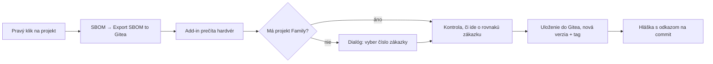

Pred exportom **uložte projekt**. Add-in exportuje iba uložený stav.

## 1. Aktivácia add-inu, raz

TIA nový add-in pri prvom štarte nahlási a **neaktivuje ho sama**. Aktivovať ho treba raz a potom znova po každej aktualizácii.

Pri prvom štarte po inštalácii TIA ukáže okno **Corporate Add-Ins updated** s riadkom **New Add-In added: TiaSbom.V21.addin** (1). Potvrďte **OK** (2).

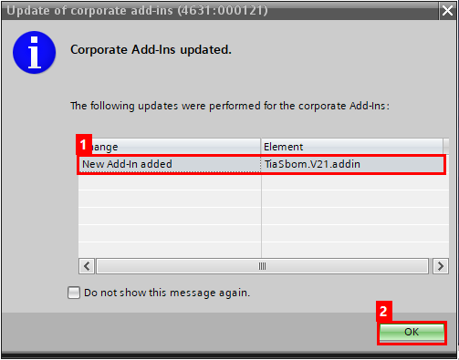

Po aktualizácii je v tom istom okne **Add-In replaced**. Aj vtedy add-in znova aktivujte.

Postup:

1. Prepnite sa do **Project view** (vľavo dole).
2. Vpravo otvorte zvislú záložku **Add-Ins**.
3. V skupine **Corporate Add-Ins** vyberte **TiaSbom.V21.addin** (1).
4. V stĺpci **Status** otvorte rozbaľovací zoznam a zvoľte **Activate** (2).

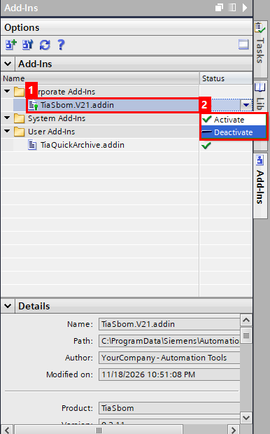

TIA zobrazí upozornenie, že add-in **nie je podpísaný** (1) a potrebuje všetky oprávnenia používateľa. Add-in číta projekt a posiela SBOM do firemnej Gitea. Potvrďte **Yes** (2).

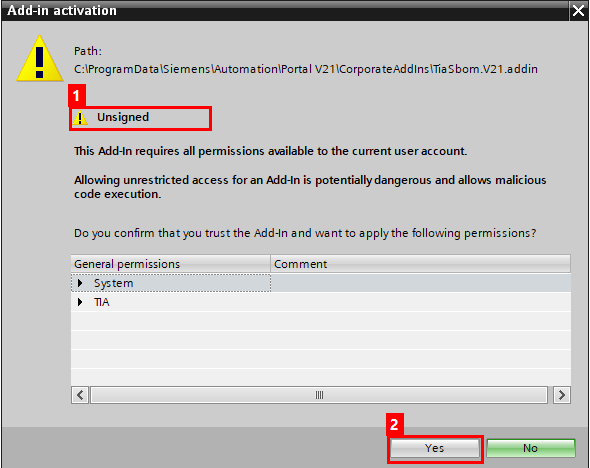

Hotovo: v stĺpci **Status** je zelená fajka (1) a v stavovom riadku *Add-In TiaSbom.V21.addin activated*.

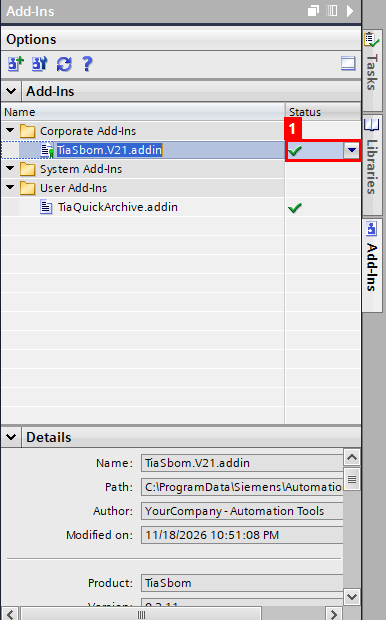

V paneli **Details** pod zoznamom vidno **Path** a **Version**. Podľa nich overíte, ktorá verzia beží.

## 2. Export

1. Otvorte a **uložte** projekt.
2. V **Project tree** kliknite pravým tlačidlom na **koreň projektu** (najvyššia položka).
3. Zvoľte **SBOM** (1) → **Export SBOM to Gitea** (2).

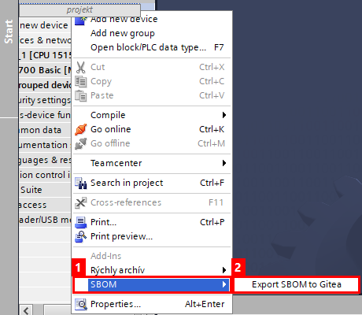

Poradie položiek pod *Add-Ins* sa môže líšiť, ak máte viac add-inov.

### Ak projekt nemá Family

Add-in spozná zákazku podľa vlastnosti projektu **Family**. Ak je prázdna, opýta sa, do ktorého projektu v Gitea SBOM patrí. Navrhne číslo zákazky zo začiatku názvu projektu (1). Skontrolujte ho a kliknite **Export** (2).

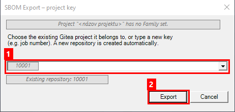

Pod poľom vidno, či repozitár už existuje (*Existing repository*) alebo sa vytvorí nový (*New repository will be created*).

Aby sa add-in nabudúce nepýtal, nastavte v TIA **Project → Properties → Family** na číslo zákazky a projekt uložte.

### Výsledok

Pri úspechu add-in ukáže, pod akým názvom verziu uložil (1). Pripojí aj odkaz na commit v Gitea.

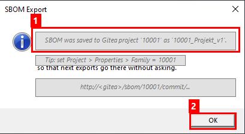

Keď exportujete rovnaký obsah znova, nič sa nezapíše a add-in to povie:

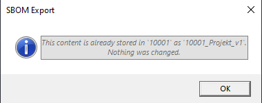

Zmenený obsah s rovnakým názvom projektu sa uloží ako nová verzia s príponou `_2`, `_3`, … Staršia verzia sa nikdy neprepíše.

## 3. Token, iba pri prvom exporte

Pri prvom exporte add-in požiada o **Gitea token** (1). Vložte ho a potvrďte **OK** (2). Token sa uloží zašifrovaný pre váš účet Windows, ďalej sa už nepýta.

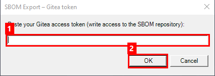

Token vytvoríte v Gitea: vpravo hore váš profil → **Settings → Applications → Generate New Token**. Oprávnenia:

| Oprávnenie | Úroveň |
|---|---|
| organization | Read and Write |
| repository | Read and Write |
| user | Read |

Token sa zobrazí iba raz. Skopírujte ho priamo do dialógu, nikam si ho neukladajte.

`user: Read` je od verzie 0.2.14. Add-in podľa neho zapíše do stĺpca **By** meno vášho Gitea účtu. Bez neho export funguje, ale zapíše meno účtu Windows, na VM s TIA často `Admin`. Starší token vymeníte tak, že vytvoríte nový podľa tabuľky a uložíte ho v PowerShelli pod svojím účtom Windows:

```powershell
& C:\ProgramData\TiaSbom\tools\tiasbom.exe --login
```

## 4. SBOM v Gitea

Každá zákazka má v organizácii `sbom` vlastný repozitár s názvom podľa čísla zákazky (1). Každá exportovaná verzia má tag (2).

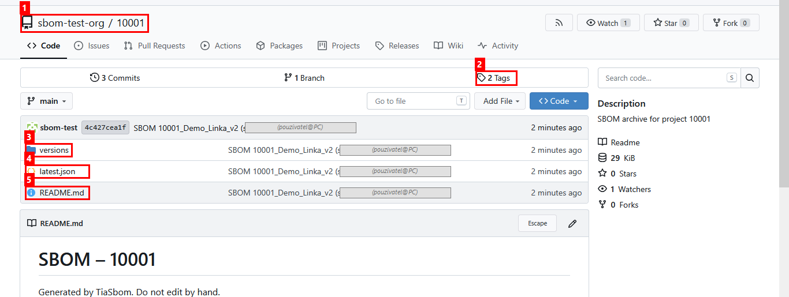

| Položka | Obsah |
|---|---|
| `versions/` (3) | Priečinok pre každú verziu projektu, v ňom `sbom.json` |
| `latest.json` (4) | Posledný export, nie úplný prehľad |
| `README.md` (5) | Prehľad všetkých verzií, generuje ho add-in |

README ukazuje všetky verzie, verziu TIA, počet modulov, čas exportu a autora (1). Autor je Gitea účet z tokenu, pri tokene bez `user: Read` účet Windows:

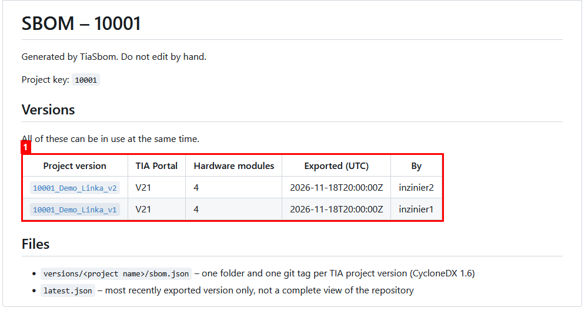

## 5. Keď niečo nejde

Každá chyba má kód `TS-…` a hneď pod ním krok, čo spraviť. Príklad: Gitea neodpovedá.

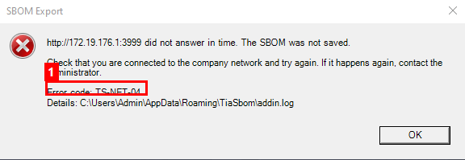

Chyby, ktoré vidno najčastejšie:

| Kód | Čo vidíte | Čo spraviť |
|---|---|---|
| `TS-NET-01` | *The server name … was not found* | Pripojiť sa do firemnej siete |
| `TS-NET-02` | *… is reachable, but the Gitea service does not answer* | Kontaktovať administrátora, Gitea je zastavená |
| `TS-NET-04` | *… did not answer in time* | Overiť sieť, skúsiť znova |
| `TS-AUTH-01` | *Gitea did not accept your token* | Exportovať znova a vložiť platný token |
| `TS-AUTH-02` | *token is valid, but it lacks permissions* | Vytvoriť token s oprávneniami podľa tabuľky vyššie |

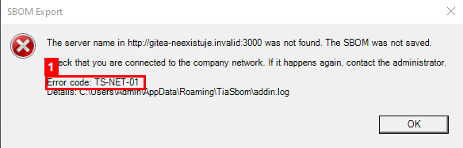

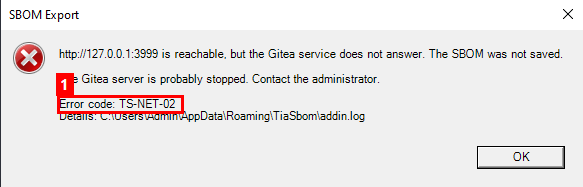

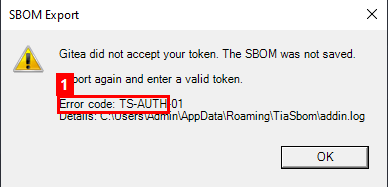

Úplný zoznam je v [11-chybove-hlasky.md](11-chybove-hlasky.md).

### Kontrola spojenia bez TIA

Dvakrát kliknite na `C:\ProgramData\TiaSbom\check.cmd`. Výsledok vyzerá takto:

```text
TiaSbom connection check, <používateľ>@<PC>
  OK      Configuration: http://<gitea>:3000, organization sbom, timeout 10 s
  OK      Token: personal token of this Windows user
  OK      Gitea server: Gitea 28.2.0
  OK      Token and organization: token accepted, sbom: 6 projects
  OK      May create projects: yes (<gitea účet>)
RESULT: OK, exports to Gitea will work.
```

Pri chybe pošlite administrátorovi screenshot tohto okna a súbor `%APPDATA%\TiaSbom\addin.log`.

### Okno sa neukáže

Okná add-inu majú od verzie 0.2.11 vlastnú ikonu **SBOM Export** na paneli úloh. Ak bliká na oranžovo, kliknite na ňu. Windows niekedy nedovolí oknu z iného procesu prevziať klávesnicu, okno je však vždy nad TIA.
