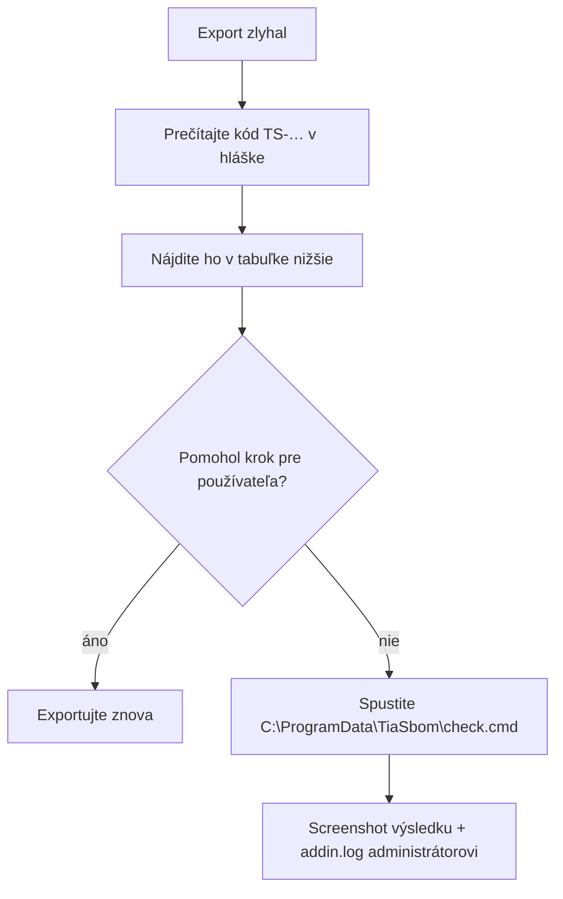

# Chybové hlášky

Každá chyba v add-ine, v `tiasbom.exe` aj v inštalátore má kód `TS-…`. Hláška má vždy tri časti:

1. čo sa stalo,
2. čo má používateľ spraviť,
3. `Error code: TS-…` a v add-ine aj `Details:` s cestou k logu.

Ak chyba nie je v tejto tabuľke, pošlite administrátorovi screenshot hlášky a súbor z riadku `Details`.

## Ako začať, keď export nejde

`check.cmd` overí po krokoch konfiguráciu, sieť, server, token, organizáciu a oprávnenia. Netreba naň TIA ani práva správcu. Prvý krok s `FAILED` ukazuje príčinu.

## Zoznam kódov

### Konfigurácia počítača

| Kód | Hláška (skrátene) | Príčina | Používateľ | Administrátor |
|---|---|---|---|---|
| `TS-CFG-01` | TiaSbom is not set up on this computer | Chýba `%ProgramData%\TiaSbom\config.json` | Kontaktovať administrátora | Spustiť `install.cmd` |
| `TS-CFG-02` | The TiaSbom configuration is damaged or incomplete | `config.json` nie je JSON, chýba `BaseUrl` alebo `Owner`, adresa nezačína `http://` ani `https://`, `TimeoutSeconds` mimo 1 až 600 | Kontaktovať administrátora | Opraviť `tiasbom.env`, znova `install.cmd` |
| `TS-SEC-01` | TiaSbom has no permission to do this on this computer | Windows nedovolí zapisovať do profilu alebo čítať súbor | Kontaktovať administrátora | Skontrolovať práva k `%APPDATA%\TiaSbom` a `%ProgramData%\TiaSbom` |

### Sieť a server

| Kód | Hláška (skrátene) | Príčina | Používateľ | Administrátor |
|---|---|---|---|---|
| `TS-NET-01` | The server name in … was not found | DNS nepozná meno servera | Overiť pripojenie k firemnej sieti | Skontrolovať DNS záznam alebo použiť IP adresu v `GITEA_BASE_URL` |
| `TS-NET-02` | … is reachable, but the Gitea service does not answer | Počítač je dostupný, ale na porte nič nepočúva | Kontaktovať administrátora | Gitea je zastavená: skontrolovať WSL a `docker compose ps`, pozri [03-gitea-server.md](03-gitea-server.md) |
| `TS-NET-03` | Cannot connect to … | Iná chyba spojenia, napríklad proxy | Overiť sieť, skúsiť znova | Pozrieť `addin.log`, technický dôvod je tam |
| `TS-NET-04` | … did not answer in time / cannot be reached | Firewall zahodil spojenie, server je preťažený alebo PC nie je vo firemnej sieti | Overiť sieť, skúsiť znova | Skontrolovať firewall servera (ESET, Windows) a `portproxy` |
| `TS-TLS-01` | … does not trust the server certificate | HTTPS certifikát Gitea vydala autorita, ktorú PC nepozná | Kontaktovať administrátora | Nainštalovať firemnú CA do `Trusted Root Certification Authorities` počítača. Pri `tls internal` nastaviť `GITEA_CA_CERT` a spustiť `install.cmd` |
| `TS-API-01` | … does not answer like a Gitea server | Na adrese odpovedá iný web, napríklad IIS, prihlasovacia stránka alebo proxy | Kontaktovať administrátora | `GITEA_BASE_URL` musí byť koreň Gitea, bez `/api/v1` |

### Token a prihlásenie

| Kód | Hláška (skrátene) | Príčina | Používateľ | Administrátor |
|---|---|---|---|---|
| `TS-AUTH-01` | Gitea did not accept your token | Token je zlý, zmazaný alebo expirovaný. Add-in ho zabudne. | Exportovať znova a vložiť nový token | Pomôcť vytvoriť token, pozri [03-gitea-server.md](03-gitea-server.md#tokeny) |
| `TS-AUTH-02` | Your Gitea token is valid, but it lacks permissions | Token nemá oprávnenia `organization` a `repository` na **Read and Write**. Add-in ho zabudne. | Vytvoriť nový token so správnymi oprávneniami, exportovať znova | Skontrolovať návod na tokeny |
| `TS-AUTH-03` | Gitea rejected the company token of TiaSbom | Servisný token z `tiasbom.env` je neplatný | Kontaktovať administrátora | Vymeniť `GITEA_TOKEN` a znova spustiť `install.cmd` |
| `TS-AUTH-04` | No token saved for this Windows user | Iba v `check.cmd`: používateľ ešte nezadal token | Raz exportovať z TIA, add-in sa spýta. Alebo `tiasbom --login`. | — |

### Gitea a projekt

| Kód | Hláška (skrátene) | Príčina | Používateľ | Administrátor |
|---|---|---|---|---|
| `TS-GIT-01` | The Gitea organization was not found, or your account cannot see it | Organizácia `sbom` neexistuje alebo používateľ nie je jej členom | Kontaktovať administrátora | Pridať účet do organizácie `sbom` s právom zápisu |
| `TS-GIT-02` | Your Gitea account may not write to this project | Účet má v organizácii iba čítanie | Kontaktovať administrátora | Pridať účet do tímu s právom zápisu a vytvárania repozitárov |
| `TS-GIT-03` | This Gitea project is archived and read-only | Repozitár zákazky bol archivovaný | Kontaktovať administrátora | V Gitea: repozitár → Settings → Unarchive, ak je nová verzia zámer |
| `TS-GIT-04` | Someone else was exporting to this project at the same moment | Súbežný export, ani päť pokusov neuspelo | Exportovať znova | — |
| `TS-GIT-05` | … reported an internal error | Gitea vrátila 5xx | Skúsiť neskôr | `docker compose logs --tail 100 gitea` |
| `TS-GIT-06` | Gitea answered 'not found' / refused the request | Neočakávaná odpoveď Gitea | Kontaktovať administrátora | Pozrieť `addin.log`, je tam stav a odpoveď Gitea |
| `TS-GIT-07` | The Gitea project contains a file that is not a valid SBOM | Niekto ručne upravil `versions/…/sbom.json` | Kontaktovať administrátora | Vrátiť súbor v histórii repozitára |

### Ostatné

| Kód | Význam |
|---|---|
| `TS-UNK-01` | Neznáma chyba. Text hlášky je technický. Pošlite screenshot a `addin.log`. |

## Hlášky bez kódu

Tieto hlášky nie sú chyby, export zámerne zastaví a povie prečo:

| Hláška | Význam | Čo spraviť |
|---|---|---|
| The project has unsaved changes. Save it first… | SBOM by opisoval neuložený stav | Uložiť projekt (Ctrl+S), exportovať znova |
| The project contains no hardware modules. | V projekte nie je žiadny hardvér | Skontrolovať, či je otvorený správny projekt |
| This SBOM may belong to a different project than '…' | Ochrana pred zámenou: iné číslo zákazky, iný hardvér alebo preklep v názve | Ak je cieľ správny, potvrdiť **Yes**. Inak **No** a opraviť `Family` v projekte |
| This content is already stored in '…' as '…'. Nothing was changed. | Rovnaký obsah už v Gitea je | Nič, je to v poriadku |
| SBOM was saved to Gitea project '…' as '…'. | Úspech, nasleduje odkaz na commit | — |
| Warning: Tag '…' was not created | SBOM je uložený, chýba iba tag | Oznámiť administrátorovi, dáta sú v poriadku |

## Kódy v inštalátore

`install.cmd` po inštalácii otestuje spojenie a zapíše výsledok do `%ProgramData%\TiaSbom\install.log`.

| Návratový kód | Význam |
|---|---|
| 0 | Hotovo, Gitea dostupná |
| 1 | Inštalácia zlyhala, dôvod je v riadku `ERROR` |
| 2 | TIA je na PC, ale pre jej verziu nie je balík |
| 3 | Nainštalované, ale Gitea z tohto PC nie je dostupná. Riadok `WARN Connection test TS-…` uvádza kód z tabuliek vyššie. |

## Kde je log

| Súbor | Obsah |
|---|---|
| `%APPDATA%\TiaSbom\addin.log` | Každý krok exportu z TIA a technický dôvod chyby. Token tam nikdy nie je. |
| `%ProgramData%\TiaSbom\install.log` | Inštalácie a testy spojenia |

Ak sa `addin.log` nedá zapísať, add-in píše do `%TEMP%\addin.log`.

## Pre vývojárov

Kódy vznikajú v `TiaSbom/src/TiaSbom.Gitea/ExportError.cs`. Test `Catalog_lists_every_code_the_code_can_produce` zlyhá, ak kód pribudne v zdrojáku a chýba v tomto dokumente. Nový kód teda vždy doplňte aj sem.
