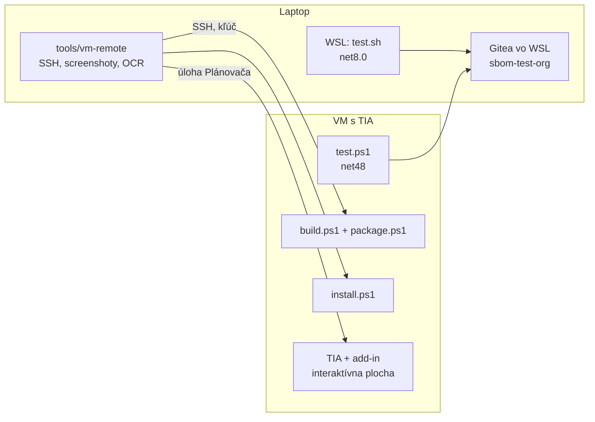

# Automatické testy a automatizácia vývoja

Tento dokument opisuje, čo sa overuje automaticky a ako spúšťať testy na laptope, vo VM a v TIA.

## Prehľad



| Úroveň | Čo overuje | Kde | Treba TIA |
|---|---|---|---|
| Unit testy | projektový kľúč, verzie, ochrana pred zámenou, JSON, SBOM | WSL, VM | nie |
| Chybové hlášky | každá chyba má správny kód `TS-…` a krok pre používateľa | WSL, VM | nie |
| Schéma | výstup je platný CycloneDX 1.6 podľa oficiálnej schémy | WSL | nie |
| Integračné | export do skutočnej Gitea, tagy, duplicity, súbežné exporty, archív, tokeny | WSL, VM | nie |
| End-to-end | inštalácia, aktivácia, export a chyby priamo v TIA | VM | áno |

Testy kompilujú zdrojáky `TiaSbom.Core` a `TiaSbom.Gitea` priamo, takže ten istý kód beží na .NET 8 aj na .NET Framework 4.8. Testovací projekt používa NuGet (xUnit, JsonSchema.Net). Pravidlá sandboxu sa naň nevzťahujú, lebo sa nikdy nenačíta v TIA.

## Stav k 2026-11-19

| Prostredie | Výsledok |
|---|---|
| WSL, net8.0, s Gitea 28.2.0 | 83 z 83 |
| VM V21, net48, bez Gitea | všetky unit testy a testy hlášok prešli |
| End-to-end na TIA V21 | export, duplicita, `TS-NET-01`, `TS-NET-02`, `TS-NET-04`, `TS-AUTH-01`, dialóg tokenu, aktivácia, aktualizácia |

## Laptop, WSL

Jednorazová príprava bez práv root:

```bash
curl -fsSL https://dot.net/v1/dotnet-install.sh -o /tmp/dotnet-install.sh
bash /tmp/dotnet-install.sh --channel 8.0 --install-dir ~/.dotnet --no-path
```

```bash
mkdir -p ~/.local/icu && cd /tmp && apt-get download libicu78 && dpkg-deb -x libicu78_*.deb ~/.local/icu
```

`test.sh` nájde .NET v `~/.dotnet` a ICU v `~/.local/icu` sám.

Spustenie vo WSL, v priečinku `TiaSbom`:

```bash
./test.sh
```

### Integračné testy proti Gitea

Integračné testy zakladajú a mažú repozitáre. Bežia iba v samostatnej organizácii `sbom-test-org` a iba proti vývojovej Gitea. **Nikdy ich nespúšťajte proti produkcii.**

Testovací účet `sbom-test` (nie admin) a tokeny vytvorí administrátor vo WSL v `~/docker/gitea`:

```bash
docker compose exec -T -u git gitea gitea admin user create --username sbom-test --email sbom-test@localhost.invalid --random-password --must-change-password=false
```

Tokeny sa uložia do `~/.config/tiasbom-test.env` s právami 600. Do Gitu nepatria.

| Premenná | Token s oprávneniami | Test |
|---|---|---|
| `TIASBOM_TEST_TOKEN` | write:organization, write:repository, read:user | všetky |
| `TIASBOM_TEST_READONLY_TOKEN` | read:organization, read:repository, read:user | `TS-AUTH-02` |
| `TIASBOM_TEST_DOC_TOKEN` | write:organization, write:repository | presne podľa dokumentácie pre používateľov |

Token vytvorí tento príkaz, `--scopes` podľa tabuľky:

```bash
docker compose exec -T -u git gitea gitea admin user generate-access-token --username sbom-test --token-name it-rw --scopes "write:organization,write:repository,read:user" --raw
```

Spustenie:

```bash
source ~/.config/tiasbom-test.env && ./test.sh --gitea
```

### Ukážkové dáta pre dokumentáciu

Screenshoty Gitea v dokumentácii pochádzajú z repozitára `sbom-test-org/10001` s vymyslenými dátami, nie zo zákazníckych projektov:

```bash
source ~/.config/tiasbom-test.env && TIASBOM_DEMO=1 ~/.dotnet/dotnet test tests/TiaSbom.Tests -f net8.0 --filter FullyQualifiedName~DemoData
```

## VM, Windows

V priečinku `TiaSbom`, v PowerShelli:

```powershell
powershell -ExecutionPolicy Bypass -File .\test.ps1
```

`-Framework net48` spustí iba runtime, v ktorom beží add-in. Prvý beh potrebuje internet kvôli NuGet.

## Automatizácia VM z laptopu

Skripty v `TiaSbom/tools/vm-remote` ovládajú VM s TIA cez SSH. Takto prebehol celý test na TIA V21 vrátane screenshotov, bez ručného klikania.

### Príprava, raz

Spúšťa používateľ, Claude nastavenia zabezpečenia nemení:

1. VM: OpenSSH Server, prihlásenie **iba kľúčom**, firewall iba z `LocalSubnet` na Hyper-V Default Switch. Ten je NAT vnútri laptopu, z firemnej siete port 22 nevidno. Skript s kľúčom je v `docs/local/setup`, lebo obsahuje verejný kľúč konkrétneho laptopu.
2. VM: prihlásený používateľ, **Basic session** vo VMConnect (nie Enhanced), uzamknutie a spánok vypnuté. Po odpojení Enhanced Session nemá plocha obraz.
3. Laptop, PowerShell:

```powershell
$env:TIASBOM_VM_HOST = (Get-VM | Get-VMNetworkAdapter | Select-Object -First 1).IPAddresses[0]
$env:TIASBOM_VM_USER = 'Admin'
```

`Get-VM` potrebuje práva správcu Hyper-V. Inak adresu prečítajte vo VM príkazom `ipconfig`.

### Skripty

| Skript | Účel |
|---|---|
| `vm.ps1 -Script x.ps1` | Skopíruje skript do VM a spustí ho cez SSH (build, inštalácia, logy) |
| `vmui.ps1 -Name x.ps1 -TaskArgs "…"` | Spustí skript z `vm/` v **interaktívnej ploche** používateľa cez úlohu Plánovača |
| `getshot.ps1 -Name n [-Marks …]` | Screenshot plochy VM do `shots\` |
| `export.ps1 -Name n` | V TIA spustí *SBOM → Export SBOM to Gitea* a odfotí výsledok |
| `vm/click.ps1 -Do "…"` | Myš a klávesnica: `click:x,y`, `right:x,y`, `ocr:Text`, `raise:Titulok`, `keys:{ENTER}`, `shot:n` |
| `vm/ocr.ps1` | OCR obrazovky cez vstavané `Windows.Media.Ocr` |
| `vm/tia.ps1 -Action start/close` | Štart a zatvorenie TIA; s otvoreným projektom iba s `-WithProject` |
| `vm/cfg.ps1 -Url … / -Restore` | Dočasne zmení `BaseUrl` pre chybové scenáre a vráti ju |
| `vm/topwin.ps1` | Poradie okien, `topmost`, vlastník; hľadanie skrytých okien |
| `../redact-screenshot.ps1` | Oreže screenshot, zakryje súkromné texty, pridá číslované rámčeky |

Čo sme sa naučili:

- SSH relácia nevidí plochu a nedešifruje DPAPI token používateľa. Všetko s TIA, oknami a tokenom preto beží cez `vmui.ps1`.
- Principal úlohy musí byť `POČÍTAČ\používateľ`, nie `WORKGROUP\používateľ`.
- Kontextové menu TIA nie je v UI Automation a samotný presun kurzora nevyvolá hover. Položky sa preto hľadajú cez OCR a celý postup beží v jednom procese, lebo menu sa zavrie pri štarte ďalšieho procesu.
- **Šípkami v menu neklikajte.** Poradie položiek pod *Add-Ins* sa mení medzi štartmi TIA. Šípky raz vybrali iný add-in.
- Screenshot zo zákazníckeho projektu nikdy nedávajte do `docs/img` bez `redact-screenshot.ps1`. Pozri [05-bezpecnost.md](05-bezpecnost.md).

## Nový chybový kód

1. Pridajte ho do `ExportError.cs`.
2. Pridajte test do `ErrorMessageTests.cs`.
3. Doplňte ho do [11-chybove-hlasky.md](11-chybove-hlasky.md). Test `Catalog_lists_every_code_the_code_can_produce` inak zlyhá.
