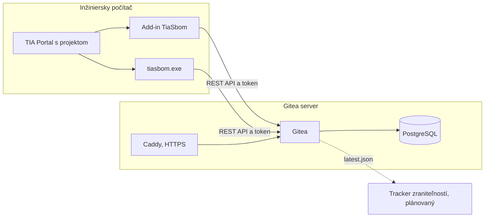

# Dokumentácia TIA SBOM Utility

TIA SBOM Utility exportuje z projektu TIA Portal softvérový kusovník (SBOM) vo formáte CycloneDX a uloží ho do Gitea. Podklad slúži na plnenie povinností podľa EU CRA. Používateľ klikne na jednu položku v TIA, zvyšok prebehne na pozadí.

Projekt je **vo vývoji**. Aktuálny stav je v [STATUS.md](STATUS.md).

## Kde čo nájsť

| Chcem | Dokument |
|---|---|
| vedieť, čo funguje a čo je ďalší krok | [STATUS.md](STATUS.md) |
| pochopiť, ako riešenie funguje a prečo | [01-architektura.md](01-architektura.md) |
| pripraviť ďalšiu VM a nasadiť add-in | [02-setup-vyvoj.md](02-setup-vyvoj.md) |
| spravovať Gitea, WSL, Docker a pripojenie | [03-gitea-server.md](03-gitea-server.md) |
| pripraviť ostrú prevádzku | [04-produkcia.md](04-produkcia.md) |
| poznať bezpečnostné pravidlá | [05-bezpecnost.md](05-bezpecnost.md) |
| čítať a vylepšovať kód | [06-kod.md](06-kod.md) |
| testovať ďalšiu verziu TIA | [07-testovanie-verzii.md](07-testovanie-verzii.md) |
| vyriešiť chybu | [08-riesenie-problemov.md](08-riesenie-problemov.md) |
| poznať pravidlá pre Claude chaty | [../CLAUDE.md](../CLAUDE.md) |

## Celkový pohľad

## Lokálne údaje

`docs/local/` je v `.gitignore`. Patria tam mená strojov, konkrétne adresy, používateľské účty a testovacie projekty. Pri novom klone ho treba vytvoriť ručne, šablóna je v [02-setup-vyvoj.md](02-setup-vyvoj.md#lokálny-súbor-prostredia).
